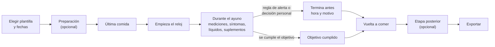

# Solicitud: app móvil de registro de ayuno — versión base

## Resumen

Se solicita una app móvil personal para **planificar y registrar ayunos de cualquier duración**: cuándo empieza y termina, qué se mide, qué se toma, cómo se siente la persona y por qué se terminó. Cada ayuno es un registro independiente con su propio plan.

La app es **genérica**: no trae datos de ninguna persona ni de ningún ayuno concreto. Todo lo que cambia de un ayuno a otro (duración, mediciones, horarios, suplementos, reglas de alerta, vuelta a comer) se configura dentro de la app, en plantillas reutilizables.

Este documento describe la **versión base**: lo mínimo necesario para registrar un ayuno completo de forma fiable y exportarlo. Lo que puede esperar está al final, en *Después de la versión base*.

## Principios

1. **Registra, recuerda y avisa; no aconseja.** La app no da recomendaciones médicas ni interpreta resultados. Las reglas de alerta las define el usuario; la app solo las aplica.
2. **Todo configurable, nada fijo en el código.** Mediciones, síntomas, horarios, reglas y textos viven en datos editables.
3. **Funciona sin internet y sin cuentas.** Los datos no salen del teléfono salvo cuando el usuario exporta.
4. **Un dato vacío es "no lo anoté", nunca cero.** "No se hizo" es un estado explícito con motivo.
5. **Hora local, al segundo.** Cada entrada guarda fecha y hora exactas en hora local.
6. **Lenguaje llano.** Frases completas, fechas con día de la semana, sin siglas ni jerga en la interfaz.
7. **Rápida de usar en ayunas.** Anotar una medición: tres toques y menos de 30 segundos.

## Alcance de la versión base

**Incluye**

- Plantillas de ayuno y creación de ayunos a partir de ellas.
- Reloj del ayuno.
- Registro de mediciones, síntomas, líquidos y electrolitos, suplementos y medicamentos, y notas.
- Recordatorios locales.
- Reglas de alerta configurables.
- Fin del ayuno con motivo.
- Plan de vuelta a comer.
- Historial de ayunos.
- Exportación e importación en JSON.

**No incluye (por ahora)**

- Conexión con sensores, básculas o relojes por Bluetooth o por sus apps.
- Gráficas avanzadas o comparaciones entre ayunos.
- Sincronización con servidores, nube, cuentas o compartir con terceros.
- Recomendaciones, diagnósticos o cálculos clínicos.
- Registro de la alimentación habitual fuera del ayuno.

## Conceptos

| Concepto | Qué es |
| --- | --- |
| **Plantilla** | Un plan reutilizable: duración objetivo, etapas, mediciones con sus horarios, suplementos que siguen o salen, reglas de alerta, metas de líquidos y plan de vuelta a comer |
| **Ayuno** | Un caso concreto creado desde una plantilla (o desde cero), con sus horas planificadas y reales |
| **Etapa** | Tramo del ayuno: preparación, ayuno, vuelta a comer, posterior. Cada plantilla decide cuáles usa y cuánto duran |
| **Medición** | Un valor con hora: glucosa, presión, peso… Sale de un catálogo editable |
| **Síntoma** | Algo que la persona siente, con intensidad 0-10. Sale de un catálogo editable; cada síntoma puede marcarse como "de alarma" |
| **Ingesta** | Lo que entra durante el ayuno: agua, infusiones, sal, electrolitos, caldo, comida |
| **Suplemento o medicamento** | Producto de la lista del usuario, con dosis, horario y estado durante el ayuno (sigue / sale / opcional) |
| **Regla** | Condición definida por el usuario que dispara un aviso o una alerta |
| **Alerta** | Registro de que una regla se cumplió y de lo que decidió el usuario |

## Recorrido de un ayuno



Las dos salidas, cumplir el objetivo o terminar antes, llevan al mismo camino. La app las trata como resultados, no como éxito o fracaso.

## Requisitos funcionales

### 1. Plantillas y plan del ayuno

- Crear, editar, duplicar y borrar plantillas.
- Una plantilla define:
    - Duración objetivo en horas.
    - Etapas que usa y su duración en días (preparación, posterior) u horas (vuelta a comer).
    - Mediciones activas y sus horarios de recordatorio por etapa.
    - Suplementos y medicamentos con su estado durante el ayuno.
    - Metas diarias de líquidos y electrolitos (opcionales).
    - Reglas de alerta.
    - Plan de vuelta a comer.
    - Lista de comprobación previa (texto libre, p. ej. "comprar sal", "cargar el tensiómetro").
    - Avisos fijos para mostrar durante ciertas etapas (texto libre).
- Crear un ayuno desde una plantilla pidiendo solo: fecha y hora de la última comida y hora prevista de inicio del reloj. El resto se calcula.
- Cada hito guarda **hora planificada** y **hora real** por separado.
- La app trae **una plantilla de ejemplo vacía de valores clínicos** para que se vea la estructura; no trae umbrales ni dosis.

### 2. Reloj

- Botón grande "Empieza el ayuno ahora" que fija la hora real; editable después con motivo.
- Pantalla principal: tiempo transcurrido, tiempo restante al objetivo, hora prevista de fin y próximo pendiente.
- Hitos configurables en la plantilla (p. ej. 12, 24, 36, 48 h).
- El reloj se calcula desde la hora de inicio guardada: sigue siendo correcto con la app cerrada o el teléfono reiniciado.

### 3. Mediciones

- Catálogo editable. Cada tipo define: nombre, unidad, si es numérico, rango válido (para detectar errores de tecleo) y campos extra.
- Catálogo precargado, todo desactivable:

| Medición | Campos | Unidades |
| --- | --- | --- |
| Glucosa | cifra, origen (sensor continuo / glucómetro), flecha de tendencia opcional | mg/dL o mmol/L |
| Cetonas | cifra, tipo (sangre / aliento / orina) | mmol/L u otra |
| Presión arterial | sistólica, diastólica, pulso, posición (sentado / de pie / acostado) | mmHg, latidos/min |
| Peso | cifra | kg o lb (se guarda lo tecleado y su equivalente) |
| Cintura | cifra | cm o in |
| Temperatura | cifra, sitio | °C o °F |
| Escalas 0-10 | hambre, energía, ánimo, claridad mental | — |

- El usuario puede añadir mediciones propias (nombre, unidad, rango).
- Fuera del rango válido la app pide confirmar; no corrige.
- Una medición pendiente se puede marcar "no se hizo" con motivo.
- Mediciones agrupadas: la presión de pie se ofrece justo después de la sentada y la app muestra la diferencia.

### 4. Síntomas

- Catálogo editable; cada síntoma tiene nombre, grupo (libre) y marca "de alarma" sí/no.
- Catálogo precargado de ejemplo (hambre, dolor de cabeza, mareo, frío, náusea, insomnio…), todo editable.
- Registro de un toque con intensidad 0-10 y nota opcional.

### 5. Líquidos y electrolitos

- Tipos editables: agua, infusiones, sal, potasio, magnesio, otros.
- Cantidad con unidad. Para la sal, la app calcula el sodio (sal × 0.393).
- Metas diarias opcionales por tipo; muestra "llevas X de Y", sin colores de juicio.
- Tipos marcados como "rompen el ayuno" (p. ej. caldo, comida): al anotarlos durante el ayuno la app pregunta si se está terminando.

### 6. Suplementos y medicamentos

- Lista del usuario: nombre, código interno, dosis, unidad y horarios.
- En cada plantilla, estado durante el ayuno: **sigue**, **sale** u **opcional**, con motivo opcional.
- Recordatorio solo de los que siguen; los que salen se muestran en gris.
- Registro por toma: tomado (hora real), no tomado (motivo) o dosis cambiada (nueva dosis y motivo).
- Lista de productos "a evitar" configurable: si se anota uno, la app avisa y lo registra igual.

### 7. Recordatorios

- Notificaciones locales a la hora exacta, también con la app cerrada y tras reiniciar el teléfono.
- Acción directa desde la notificación ("Anotar glucosa").
- Posponer 10 o 30 minutos, o marcar "no se hizo".
- Silencio nocturno configurable, salvo los recordatorios que programe una regla de alerta.

### 8. Reglas de alerta

El usuario define las reglas; la app no trae umbrales clínicos. Cada regla tiene:

| Campo | Opciones |
| --- | --- |
| Condición | Medición por debajo / por encima de un valor · Medición fuera de rango **sostenida** N minutos (dos o más lecturas que abarquen ese tiempo) · Síntoma de alarma marcado · Total diario de un tipo de ingesta bajo la meta a una hora dada · Botón manual "algo no va bien" |
| Filtro opcional | Solo en ciertas etapas · Solo despierto / solo al despertar · Solo con cierto contexto (p. ej. de pie) |
| Nivel | Aviso (amarillo) o alerta (rojo) |
| Mensaje | Texto libre que se muestra tal cual |
| Acción | Ninguna · Programar una nueva medición en N minutos · Ofrecer terminar el ayuno |

Comportamiento obligatorio:

- La app **nunca termina el ayuno por su cuenta**: muestra la alerta y el usuario elige "termino el ayuno" o "sigo" (con motivo).
- Toda alerta queda registrada con hora, regla, lecturas que la dispararon y la decisión del usuario.
- Botón de seguridad siempre visible que muestra las reglas activas en lenguaje llano y el contacto de emergencia (opcional, con llamada de un toque).
- Las reglas se evalúan al guardar cada entrada y al llegar cada hora programada.

### 9. Fin del ayuno

- Botón "Terminar el ayuno": hora real y motivo obligatorio (objetivo cumplido, regla de alerta, decisión personal, otro + texto).
- Duración final calculada.
- Un ayuno terminado no se reanuda; se crea otro.

### 10. Vuelta a comer

- Plan definido en la plantilla como una lista de pasos: descripción, hora relativa al fin del ayuno o intervalo de repetición (p. ej. "una taza de caldo cada 60 minutos durante 4 horas").
- Recordatorio de cada paso y casilla de hecho.
- Registro de cada comida: hora, descripción, cantidad aproximada y cómo cayó (bien, pesadez, náusea, diarrea, otro).
- Pasos de reintroducción por día (p. ej. "vuelven los suplementos", "vuelve tal alimento"), cada uno con fecha calculada y casilla.

### 11. Historial

- Lista de ayunos: fecha, duración, objetivo y motivo de fin.
- Dentro de cada ayuno: línea de tiempo con todas las entradas en orden, y totales de líquidos por día.
- Editar o borrar cualquier entrada; cada cambio queda en una bitácora con el valor anterior.

### 12. Notas

- Nota libre con hora en cualquier momento.

## Modelo de datos

Un ayuno es el registro padre; todo lo demás cuelga de él como eventos con hora. El modelo es **largo** (una fila por valor) para poder añadir tipos de medición sin migrar el esquema.

| Tabla | Campos principales |
| --- | --- |
| `templates` | `id`, `name`, `target_hours`, `config` (etapas, horarios, metas, avisos, lista previa), `created_at`, `updated_at` |
| `fasts` | `id`, `template_id`, `name`, `last_meal_planned`, `last_meal_actual`, `clock_start_planned`, `clock_start_actual`, `target_hours`, `end_planned`, `end_actual`, `end_reason`, `end_reason_detail`, `status` (planificado / en curso / terminado), `notes` |
| `stages` | `id`, `fast_id`, `stage`, `start_at`, `end_at` |
| `metric_types` | `code`, `name`, `unit`, `alt_unit`, `numeric`, `min_valid`, `max_valid`, `extra_fields`, `active` |
| `measurements` | `id`, `fast_id`, `taken_at`, `metric_code`, `value_num`, `value_text`, `unit`, `value_entered`, `unit_entered`, `context`, `source`, `trend`, `group_id`, `not_done_reason`, `note` |
| `symptom_types` | `code`, `name`, `group`, `is_alarm`, `active` |
| `symptoms` | `id`, `fast_id`, `noted_at`, `symptom_code`, `severity`, `note` |
| `intake_types` | `code`, `name`, `unit`, `breaks_fast`, `sodium_factor` |
| `intakes` | `id`, `fast_id`, `taken_at`, `intake_code`, `amount`, `unit`, `note` |
| `products` | `code`, `name`, `kind` (suplemento / medicamento), `default_amount`, `unit`, `avoid` |
| `product_plan` | `id`, `fast_id` o `template_id`, `product_code`, `time_of_day`, `amount`, `unit`, `during_fast` (sigue / sale / opcional), `reason` |
| `product_log` | `id`, `fast_id`, `product_code`, `scheduled_at`, `taken_at`, `amount`, `unit`, `status` (tomado / no tomado / dosis cambiada), `reason` |
| `rules` | `id`, `template_id`, `name`, `condition`, `filters`, `level`, `message`, `action`, `active` |
| `alerts` | `id`, `fast_id`, `rule_id`, `fired_at`, `trigger_ids`, `user_choice`, `note` |
| `refeed_steps` | `id`, `fast_id`, `description`, `scheduled_at`, `done_at`, `tolerance`, `note` |
| `notes` | `id`, `fast_id`, `noted_at`, `text` |
| `edits` | `id`, `table`, `row_id`, `edited_at`, `field`, `old_value`, `new_value`, `reason` |

Reglas del modelo:

- Toda fila de evento lleva `id` UUID v4 estable, `created_at`, `updated_at` y `deleted_at` (borrado blando).
- Fechas y horas en hora local con segundos; el desfase horario del dispositivo se guarda aparte.
- Se guarda lo tecleado con su unidad (`value_entered`, `unit_entered`) y, aparte, el valor en la unidad del catálogo. Nunca uno en lugar del otro.
- Los derivados (duración, totales diarios, sodio, diferencia sentado/de pie) **se calculan**, no se almacenan.

## Exportación e importación

**Exportar**

- Por ayuno o todo junto, a un archivo `ayuno_<AAAA-MM-DD>_<8 primeros caracteres del id>.json` (la fecha es la del inicio real del reloj).
- Se entrega por la hoja de compartir del sistema. La app no sube nada por su cuenta.
- Opcional: `.zip` con un `.csv` por tabla.

**Reglas del formato**

- UTF-8 sin BOM, JSON válido, claves en inglés y en `snake_case`.
- Fechas `"2026-10-23T07:02:15"` (hora local, sin zona, con segundos) y `"2026-10-23"`. El desfase va una vez en la cabecera (`"tz_offset": "-05:00"`). No convertir a UTC.
- Números como números, con punto decimal.
- `null` = "no se anotó"; nunca `0` ni `""` en su lugar.
- Los `id` no cambian al editar: reexportar el mismo ayuno produce los mismos `id`, así quien lo cargue sustituye en vez de duplicar.
- Las filas borradas se exportan con `deleted_at` lleno.
- Los catálogos y la plantilla usada viajan dentro del archivo, para poder leerlo sin la app.

**Estructura**

```json
{
  "schema": "fasting-log",
  "schema_version": "1.0",
  "app_version": "1.0.0",
  "exported_at": "2026-10-25T14:03:11",
  "tz_offset": "-05:00",
  "person": { "name": null, "id_number": null, "birth_date": null },
  "catalogs": {
    "metric_types": [], "symptom_types": [], "intake_types": [], "products": []
  },
  "templates": [],
  "fasts": [],
  "stages": [],
  "measurements": [],
  "symptoms": [],
  "intakes": [],
  "product_plan": [],
  "product_log": [],
  "rules": [],
  "alerts": [],
  "refeed_steps": [],
  "notes": [],
  "edits": []
}
```

El bloque `person` es opcional y va vacío salvo que el usuario lo active en ajustes.

Ejemplo de una medición:

```json
{
  "id": "3f6c2a9e-8b1d-4e57-9a0c-2d7e5b1f4c88",
  "fast_id": "b1e0c7d4-5a2f-4c3e-8f61-9d0a7e2b3c14",
  "taken_at": "2026-10-23T12:01:40",
  "metric_code": "glucose",
  "value_num": 64,
  "value_text": null,
  "unit": "mg/dL",
  "value_entered": 64,
  "unit_entered": "mg/dL",
  "context": null,
  "source": "cgm",
  "trend": "steady",
  "group_id": null,
  "not_done_reason": null,
  "note": null,
  "created_at": "2026-10-23T12:02:05",
  "updated_at": null,
  "deleted_at": null
}
```

**Importar**

- Plantillas (para compartirlas o restaurarlas).
- Lista de productos.
- Restaurar desde un archivo exportado por la propia app, sin duplicar (misma llave `id`).
- Campos desconocidos: se importa igual y se listan los ignorados. `schema_version` mayor que la soportada: se rechaza con un mensaje claro.

**Entregables**: JSON Schema (draft 2020-12) del archivo y un archivo de ejemplo con un ayuno simulado completo.

## Pantallas

| Pantalla | Qué muestra | Acción principal |
| --- | --- | --- |
| Inicio (sin ayuno) | Próximo ayuno planificado, último ayuno, botón "Nuevo ayuno" | Crear ayuno |
| Inicio (ayuno en curso) | Reloj grande, tiempo al objetivo, próximo pendiente, totales del día frente a metas, última medición | "Anotar" y botón de seguridad siempre visibles |
| Anotar | Rejilla de botones grandes con las mediciones activas, Síntoma, Líquido, Suplemento, Nota | Un toque abre un formulario de una sola pantalla con teclado numérico |
| Hoy | Línea de tiempo del día: hecho, pendiente, atrasado, no hecho | Tocar un pendiente lo abre ya rellenado |
| Seguridad | Reglas activas en lenguaje llano, contacto de emergencia | "Terminar el ayuno" |
| Vuelta a comer | Pasos con su hora, comidas, reintroducción | Casillas |
| Historial | Ayunos pasados y su línea de tiempo | Exportar |
| Plantillas | Lista y editor de plantillas | Crear, duplicar |
| Ajustes | Unidades, catálogos, productos, silencio nocturno, contacto, exportar/importar, copia de seguridad | — |

**Diseño**

- Tema claro y oscuro.
- Texto mínimo 17 pt, botones de al menos 48 × 48 puntos, alto contraste, compatible con el tamaño de letra del sistema y con el lector de pantalla.
- Rojo reservado para las alertas. Las cifras no se pintan de verde o rojo por sí solas: eso es un juicio clínico que la app no hace.
- Fechas con día de la semana ("viernes 23 de octubre"); la hora del ayuno ("hora 33") siempre junto a la fecha y hora reales.
- Idioma de la interfaz: español; textos en archivos de traducción para poder añadir otros.

## Requisitos no funcionales

**Plataforma**

| Opción | A favor | En contra |
| --- | --- | --- |
| App nativa multiplataforma (Flutter o React Native con Expo) — **recomendada** | Recordatorios locales fiables a hora exacta, almacenamiento SQLite, Android e iPhone con el mismo código | En iPhone exige cuenta de desarrollador o TestFlight |
| App web instalable (PWA) | Sin tienda de apps, un solo código | Las notificaciones programadas sin servidor no son fiables, sobre todo en iPhone; en esta app un recordatorio perdido es un fallo de seguridad |

**Fiabilidad**

- Cada entrada se guarda en SQLite antes de confirmarse en pantalla.
- Ninguna pérdida de datos si se cierra la app, se agota la batería o se reinicia el teléfono.
- Recordatorios reprogramados solos tras reiniciar el teléfono o cambiar la hora o la zona horaria.
- Abrir y mostrar el reloj en menos de 1 segundo.

**Privacidad**

- Datos cifrados en el dispositivo; bloqueo opcional con huella o PIN.
- Sin analítica, publicidad ni bibliotecas que envíen datos a terceros.
- Copia de seguridad manual a un archivo cifrado.

**Mantenimiento**

- Repositorio propio con README de compilación e instalación.
- Pruebas automáticas del motor de reglas, del reloj y del formato de exportación.
- `schema_version` en la exportación; un cambio incompatible sube la versión mayor y se documenta.

## Criterios de aceptación

- [ ] En modo avión: crear una plantilla, crear un ayuno desde ella, iniciar el reloj y anotar cada tipo de medición, síntoma, líquido y suplemento sin error.
- [ ] Tras forzar el cierre de la app y reiniciar el teléfono, el reloj marca el mismo tiempo transcurrido y no falta ninguna entrada.
- [ ] Los recordatorios configurados suenan a su hora con la app cerrada durante 3 días seguidos.
- [ ] Una regla "glucosa bajo X sostenida 20 minutos" dispara con dos lecturas bajo X separadas 20 minutos o más, y **no** dispara con una sola.
- [ ] Una regla sobre un síntoma de alarma dispara al marcarlo, con cualquier valor de las mediciones.
- [ ] Una regla con acción "medir de nuevo en 15 minutos" programa ese recordatorio.
- [ ] Ninguna alerta termina el ayuno sin la confirmación del usuario, y todas quedan registradas con su decisión.
- [ ] Anotar un tipo de ingesta marcado "rompe el ayuno" durante el ayuno pregunta si se está terminando.
- [ ] 5 g de sal muestran 1.97 g de sodio.
- [ ] Un peso tecleado en lb se guarda en lb y en kg; al exportar aparecen los dos.
- [ ] Un campo no anotado se exporta como `null`.
- [ ] El archivo exportado valida contra el JSON Schema; importarlo dos veces no duplica filas.
- [ ] Exportar, desinstalar, reinstalar e importar restaura todos los ayunos y plantillas con las horas al segundo.
- [ ] Editar una entrada conserva su `id` y deja el valor anterior en la bitácora.
- [ ] Anotar una medición toma 3 toques o menos desde la pantalla principal.
- [ ] Ningún texto de la interfaz usa siglas sin explicar.

## Después de la versión base

En orden de utilidad probable, para decidir más adelante:

1. Gráficas por ayuno (mediciones en el tiempo con las alertas marcadas) y comparación entre ayunos.
2. Widget en la pantalla de inicio con el reloj y el próximo pendiente.
3. Importar las lecturas de un sensor continuo de glucosa desde su archivo exportado, para verlas junto a lo anotado.
4. Lectura de Apple Salud / Health Connect (peso, pulso, sueño).
5. Nota de voz transcrita.
6. Registro de la ventana diaria de comidas (ayuno de cada noche), además de los ayunos largos.
7. Envío opcional a un servidor propio en la red de casa.

## Preguntas abiertas

- [ ] ¿Android, iPhone o ambos?
- [ ] ¿Unidades por defecto: mg/dL o mmol/L, kg o lb, °C o °F?
- [ ] ¿Contacto de emergencia en la versión base o después?
- [ ] ¿Alguno de los puntos de *Después de la versión base* debe entrar ya en la primera entrega?
