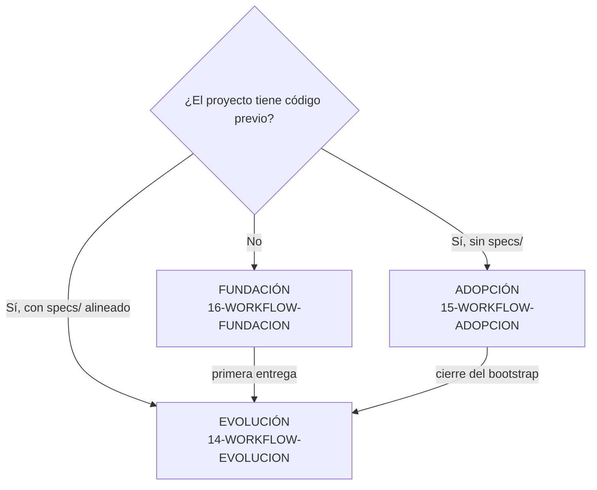
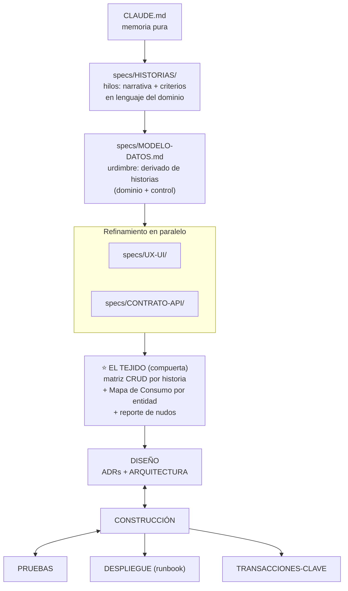

# 01 — Mapa del Método TRAMA

Lectura de orientación: qué fases existen, en qué orden, qué workflow aplica a cada situación y dónde vive el detalle. El razonamiento detrás de cada decisión está en `00-PRINCIPIOS.md`.

---

## Elegir workflow



Fundación y Adopción son **de una sola vez**. Todo lo demás — cada feature, cada cambio de regla, cada módulo nuevo — es una **Evolución**.

## El flujo de fases (Fundación)



Las flechas bidireccionales son intencionales: Diseño, Construcción y Pruebas se retroalimentan. **No es cascada.**

## Artefactos del proyecto (`specs/`)

| Artefacto | Forma | Contenido |
|---|---|---|
| `HISTORIAS/` | directorio (archivo por historia) | Narrativa, criterios, matriz CRUD |
| `MODELO-DATOS.md` | archivo único | Entidades (dominio + control), clasificación, glosario, Mapa de Consumo |
| `UX-UI/` | directorio (archivo por flujo) | Pantallas, wireframes textuales, campos canónicos |
| `CONTRATO-API/` | directorio (archivo por servicio) | Endpoints, payloads, auth, errores |
| `DISENO.md` | archivo único | ADRs (incluye `SEG-*`) |
| `ARQUITECTURA.md` | archivo único | Capas, patrones, checklist, deuda arquitectónica |
| `PRUEBAS.md` | archivo único | Estrategia y casos por historia |
| `DESPLIEGUE.md` | archivo único | Runbook (el método documenta; no ejecuta el deploy) |
| `TRANSACCIONES-CLAVE/` | directorio (archivo por transacción) | Secuencia, fallos, rollback |
| `GUIA-ESTILO.md` | archivo único | Tokens visuales, componentes, accesibilidad |
| `EVOLUCIONES-EN-CURSO.md` | archivo único | Tabla de evoluciones activas (coordinación) |
| `EVOLUCIONES-HISTORICAS/` | directorio | Memoria por evolución cerrada |
| `DEUDA-INICIAL.md` | archivo único (solo Adopción) | Nudos catalogados del primer Tejido |

## Los 17 skills

El instalador copia por manifiesto los skills **comunes** (ambos modos) más los del **modo instalado** — un proyecto Fundación no recibe los de Adopción ni viceversa, porque ningún proyecto cruza de workflow: ambos desembocan en Evolución.

| Skill | Opera | Workflow | Se instala en |
|---|---|---|---|
| `/trama-tejer` | El Tejido (completo, parcial o diagnóstico) | Todos | Ambos modos |
| `/trama-construir` | Ciclo autónomo hilar → aplicar → verificar | Fundación, Evolución | Ambos modos |
| `/trama-evolucion` | Orquestador de las 5 fases de una evolución | Evolución | Ambos modos |
| `/trama-evolucion-plan` | Pasos 1-3 (intención, impacto, registro) | Evolución | Ambos modos |
| `/trama-evolucion-actualizar` | Paso 4 (actualizar artefactos) | Evolución | Ambos modos |
| `/trama-evolucion-verificar` | Pasos 5a-5b (mini-Tejido + revisión cruzada) | Evolución | Ambos modos |
| `/trama-evolucion-cerrar` | Paso 7 (cierre y memoria) | Evolución | Ambos modos |
| `/trama-evolucion-retomar` | Paso 0 (diagnóstico de evolución en curso) | Evolución | Ambos modos |
| `/trama-fundacion` | Orquestador de los 8 pasos del proyecto nuevo | Fundación | Solo `--fundacion` |
| `/trama-fundacion-historias` | Paso 2 (levantar historias por entrevista) | Fundación | Solo `--fundacion` |
| `/trama-fundacion-modelo` | Paso 3 (derivar el modelo desde las historias) | Fundación | Solo `--fundacion` |
| `/trama-fundacion-definicion` | Paso 4 (UX-UI + Contrato de API en paralelo) | Fundación | Solo `--fundacion` |
| `/trama-adopcion` | Orquestador de las 4 fases del bootstrap | Adopción | Solo `--adopcion` |
| `/trama-adopcion-inventario` | Fase 1 (discovery del código existente) | Adopción | Solo `--adopcion` |
| `/trama-adopcion-andamiaje` | Fase 2 (memoria, rules, esqueleto de specs/) | Adopción | Solo `--adopcion` |
| `/trama-adopcion-extraccion` | Fase 3 (extracción mecánica desde el código) | Adopción | Solo `--adopcion` |
| `/trama-adopcion-cierre` | Fase 4 (historias inversas, Tejido diagnóstico, deuda) | Adopción | Solo `--adopcion` |

La lista exacta instalada queda registrada en `.trama-config.yaml` (`skills_instalados`). Los prompts sugeridos de los documentos `03`-`06` siguen disponibles como alternativa manual a los skills de definición de Fundación.

## Estructura de integración y cadencias

```text
<proyecto>/
├── .claude/            ← cambia esporádicamente (adopción de skills)
├── metodo/             ← casi nunca cambia (solo upgrade de versión)
├── specs/              ← cambia constantemente (artefactos vivos)
├── CLAUDE.md           ← cambia poco (memoria pura, ~150 líneas)
└── .trama-config.yaml  ← fuente de verdad de la instalación
```

`metodo/` es **referencia inmutable**: nadie del proyecto lo edita. `specs/` no lo crea el instalador — se materializa al levantar la primera historia (Fundación) o con `/trama-adopcion-andamiaje` (Adopción).
