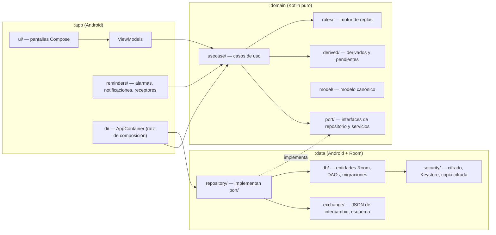

# Arquitectura — ayuno-app

Descripción operacional de cómo está organizado el código. Las razones de cada decisión están en `specs/DISENO.md` (ADRs). Leer antes de crear módulos, paquetes o capas nuevas.

## 1. Capas y responsabilidades

| Capa | Módulo y paquete | Responsabilidad | No hace |
|---|---|---|---|
| UI | `:app/ui/<flujo>/` | Pantallas Compose de cada flujo de `specs/UX-UI/`; muestra estado, envía eventos | Lógica de negocio, acceso a datos, decidir alertas |
| Presentación | `:app/ui/<flujo>/*ViewModel` | Convierte eventos en llamadas a casos de uso; expone `StateFlow<UiState>` con los estados vacío, cargando, error y sin permisos | SQL, cálculos de dominio |
| Sistema | `:app/reminders/` | Programa alarmas (ADR-005), construye notificaciones y sus acciones, receptores de arranque y cambio de hora | Decidir qué está pendiente (lo calcula el dominio) |
| Composición | `:app/di/` | Crea el grafo de objetos (ADR-009); único lugar de `:app` que conoce `:data` | Lógica |
| Casos de uso | `:domain/usecase/` | Una clase por operación de historia (`StartFast`, `RecordMeasurement`, `EndFast`…); orquesta repositorios y transacciones | Saber de Android o Room |
| Reglas | `:domain/rules/` | `RuleEngine` puro (ADR-006) | Efectos (mostrar, programar) |
| Derivados | `:domain/derived/` | Fin previsto, hitos, duraciones, totales, sodio, pendientes del día y su estado, hora del ayuno | Persistir derivados |
| Modelo | `:domain/model/` | Tipos con nombres canónicos (`Fast`, `Measurement`, `Rule`…) y sus invariantes | Anotaciones de Room o de serialización |
| Puertos | `:domain/port/` | Interfaces: `FastRepository`, `RecordRepository`, `TransactionRunner`, `ExchangeCodec`… | Implementaciones |
| Repositorios | `:data/repository/` | Implementan los puertos; mapean entidades Room ↔ modelo | Reglas de negocio |
| Base de datos | `:data/db/` | Entidades Room (`*Entity`), DAOs, convertidores, migraciones, carga inicial (ADR-008) | Exponer entidades Room fuera de `:data` |
| Intercambio | `:data/exchange/` | Serializar y validar el formato de ADR-007; importación todo o nada (ADR-SEG-006) | Decidir qué se exporta (lo decide el caso de uso) |
| Seguridad | `:data/security/` | Clave de SQLCipher en Keystore (ADR-SEG-001), copia cifrada (ADR-SEG-005) | Lógica de bloqueo de la UI (está en `:app`) |

### Direcciones de dependencia permitidas

- `:app` → `:domain` ✔
- `:data` → `:domain` ✔
- `:app` → `:data` ✔ **solo** desde `:app/di/` (raíz de composición)
- `:domain` → nada del proyecto; tampoco Android, Room ni `kotlinx.serialization` ✔
- Dentro de `:app`: `ui` → `ViewModel` → `usecase`; las pantallas nunca llaman a casos de uso directamente.
- Prohibido: `:domain` → `:data` o `:app`; `ui/` → `:data`; un ViewModel → DAO; un caso de uso → otro ViewModel.

La regla de módulos la impone Gradle. La regla «`:app` → `:data` solo desde `di/`» se verifica con una prueba de arquitectura (ver §3).

## 2. Patrones aplicados

| Patrón | Dónde | Por qué |
|---|---|---|
| Puertos y adaptadores (hexagonal ligero) | `:domain/port` ↔ `:data/repository` | El dominio se prueba sin Android (ADR-002) |
| Caso de uso (una clase por operación) | `:domain/usecase` | Cada operación de una historia tiene un punto de entrada que se prueba contra su matriz CRUD |
| Repository | `:data/repository` | Aísla Room y el cifrado |
| Unidad de trabajo | `TransactionRunner` (puerto) implementado con `withTransaction` de Room | Operaciones multi-entidad atómicas (transacciones clave) |
| Flujo unidireccional (MVVM) | `:app/ui` | Estado único por pantalla, recomposición predecible |
| Especificación / función pura | `RuleEngine`, `derived/` | Comportamiento crítico verificable con tablas de casos |
| Copia de plan (prototipo) | `CreateFastFromTemplate`, `DuplicateTemplate` | El ayuno conserva su plan aunque cambie la plantilla (D-03) |
| Bitácora de auditoría | `RecordEditor` escribe la entrada y `edit_log` en una transacción | S8; H-034 |

### Organización por funcionalidad

Los paquetes de `ui/`, `usecase/` y `repository/` se agrupan por las mismas áreas que las historias y el modelo:

| Área | Historias | Entidades principales |
|---|---|---|
| `plan` | H-001–H-003, H-014, H-031 (definir) | template, stage, plan_metric, metric_schedule, intake_goal, checklist_item, stage_notice, plan_product, refeed_step |
| `fast` | H-004–H-006, H-030 | fast |
| `record` | H-008–H-010, H-012, H-015, H-032, H-035 | measurement, blood_pressure_reading, symptom, intake, product_log, meal, note |
| `catalog` | H-007, H-010, H-011, H-013 | metric_type, symptom_type, intake_type, product, product_schedule |
| `rules` | H-019–H-029 | rule, alert |
| `refeed` | H-031, H-032 | refeed_step, refeed_check, meal |
| `reminders` | H-016–H-018 | (derivados de horarios) |
| `history` | H-033, H-034 | todas las de registro, edit_log |
| `exchange` | H-036–H-040 | todas |
| `settings` | H-017, H-029, H-038, H-042, H-043 | settings, person_profile, emergency_contact |

## 3. Checklist para nuevas features

Para cada historia (o cambio de una evolución):

1. **Leer** la historia, su matriz CRUD y el flujo de `specs/UX-UI/`; usar exactamente los nombres canónicos de la matriz.
2. **Modelo de dominio:** si falta un campo, parar: el cambio va primero al modelo y al Tejido (no se inventan campos).
3. **Persistencia (`:data/db/`):** entidad Room y DAO; si cambia el esquema, **subir la versión de `AyunoDatabase`, escribir la migración en `Migrations` (SQL tomado del `N.json` exportado) con su prueba en `MigrationTest`, y añadir el identificador de la versión publicada a `ReleasedSchemasTest`**; actualizar `schema/fasting-log-*.schema.json` y su versión si el campo viaja en el archivo (ADR-007).
4. **Puerto y repositorio:** método en la interfaz de `:domain/port/` e implementación en `:data/repository/`; mapeo explícito entidad ↔ modelo.
5. **Caso de uso (`:domain/usecase/<área>/`):** una clase por operación; escrituras multi-entidad dentro de `TransactionRunner`; si toca entradas de registro, evaluar reglas en la misma transacción (ADR-006); si cambia el plan o los horarios, avisar al `ReminderScheduler`.
6. **ViewModel y pantalla (`:app/ui/<flujo>/`):** `UiState` con los cuatro estados no felices; textos en `strings.xml`; componentes y tokens de `specs/GUIA-ESTILO.md`; semántica de accesibilidad en cada control.
7. **Seguridad:** clasificación de los campos tocados (S4): nada Crítico ni PII en logs; pantallas con datos de salud bajo `FLAG_SECURE`; entradas externas validadas (S1).
8. **Pruebas mínimas:**
   - Unitarias en `:domain`: cada criterio de aceptación y cada fila C/U/D de la matriz.
   - Integración en `:data`: el repositorio persiste y lee lo que dice la matriz (Room en memoria con SQLCipher desactivado solo en pruebas).
   - E2E (`app/src/androidTest/`) solo para historias de prioridad alta, nombradas por historia (`.claude/rules/pruebas-e2e.md`).
   - Si la operación es transacción clave: un caso por fila de «Manejo de fallos».
9. **Transacción clave:** si califica (doc 12), documentarla en `specs/TRANSACCIONES-CLAVE/`.
10. **Cierre:** lint y pruebas en verde; actualizar el estado de la historia en el índice.

**Prueba de arquitectura:** una prueba en `:app` (inspección de imports) falla si algún archivo fuera de `di/` importa `com.ayuno.data`. Una prueba de construcción verifica que el manifiesto final no contiene `android.permission.INTERNET` (ADR-SEG-004).

## 4. Transacciones clave previstas

Operaciones que califican según doc 12; se documentan al construirlas (paso 8):

| Transacción | Historias | Por qué califica |
|---|---|---|
| Crear ayuno desde plantilla | H-004 | Escribe `fast` y copia 9 entidades de plan; programa alarmas |
| Duplicar plantilla | H-003 | Copia multi-entidad |
| Empezar el ayuno | H-005 | `fast` + `edit_log` (si corrige) + reprogramar alarmas (efecto externo) |
| Guardar entrada con evaluación de reglas | H-008–H-012, H-019–H-027 | Entrada + `alert` en una transacción; programa recordatorio de regla |
| Terminar el ayuno | H-030, H-031 | `fast` + generación de `refeed_check` + alarmas |
| Corregir o borrar entrada | H-034, H-005 | Entrada + `edit_log` |
| Exportar | H-036, H-037 | Efecto externo (archivo, hoja de compartir) |
| Importar / restaurar | H-039, H-040 | Escritura masiva, todo o nada |
| Copia cifrada y su restauración | H-042 | Archivo externo + escritura masiva |

## 5. Deuda arquitectónica conocida

| Deuda | Razón | Plan |
|---|---|---|
| Sin icono de la app | No lo pide ninguna historia | Añadir antes de la primera instalación |
| `USE_EXACT_ALARM` incompatible con publicar en Google Play | La distribución es por APK (ADR-005) | Revisar ADR-005 si se decide publicar en Play |
| Columnas JSON no consultables por SQL | Listas pequeñas (ADR-003) | Normalizar si aparece una consulta que lo necesite |

## 6. Log de decisiones

| Fecha | Decisión | ADR |
|---|---|---|
| 2026-10-08 | Kotlin + Compose, una actividad | ADR-001 |
| 2026-10-08 | Módulos `:app` / `:domain` / `:data` y direcciones de dependencia | ADR-002 |
| 2026-10-08 | Room sobre el modelo canónico | ADR-003 |
| 2026-10-08 | Hora local sin zona, `Clock` inyectado | ADR-004 |
| 2026-10-08 | Alarmas de despertador para recordatorios | ADR-005 |
| 2026-10-08 | Motor de reglas puro en `:domain` | ADR-006 |
| 2026-10-08 | Formato de intercambio JSON + esquema | ADR-007 |
| 2026-10-08 | Datos precargados en assets, textos en recursos | ADR-008 |
| 2026-10-08 | Inyección manual | ADR-009 |
| 2026-10-08 | Seguridad: cifrado, bloqueo, exportación, sin red, copia cifrada, importación | ADR-SEG-001 a 006 |
| 2026-10-08 | Construcción: solo la siguiente alarma programada (enmienda de ADR-005) | ADR-005 |
| 2026-10-08 | Construcción: integridad de propietario de plan con triggers SQLite creados en `onCreate` (Room no declara CHECK) | ADR-003 |
| 2026-10-08 | Construcción: `RuleValidator` solo acepta condiciones y acciones ya construidas; el motor ya soporta los filtros de H-024 | ADR-006 |
| 2026-10-08 | Construcción: el origen de la glucosa viene preseleccionado en «Sensor continuo» (wireframe de UX) para cumplir los 3 toques de H-008 | — |
| 2026-10-08 | Construcción: kotlinx-serialization 1.7.3 en `:data` (datos precargados; formato de intercambio, ADR-007) | ADR-008 |
| 2026-10-08 | Tanda 2a: «algo no va bien» sin regla manual crea en el plan del ayuno una regla manual con el texto neutro de la app, en la misma transacción que la alerta (decisión de UX aceptada + H-027: toda alerta queda registrada) | ADR-006 |
| 2026-10-08 | Tanda 2a: las reglas se evalúan en cada alarma (pendientes y horas de comprobación de reglas de ingesta) además de al guardar (H-019, H-022) | ADR-005, ADR-006 |
| 2026-10-08 | Incidente: la tanda 2a cambió el esquema sin subir la versión y la app se cerraba al abrir en el teléfono. Se añade la versión 2 con migración 1→2 probada y un candado de esquemas publicados (`ReleasedSchemasTest`); se cierra la deuda «versión 1 sin migraciones» | ADR-003 |
| 2026-10-08 | Tanda 2a: en el editor de productos, la dosis de cada horario es la dosis habitual; el modelo admite dosis distintas por horario (editable en una evolución si hace falta) | — |

## 7. Versiones y dependencias

Plataforma: `minSdk 29` (Android 10), `targetSdk`/`compileSdk 35` (Android 15; se ejecuta en Android 16). `applicationId` `com.ayuno`; paquetes `com.ayuno.app`, `com.ayuno.domain`, `com.ayuno.data`. Catálogo de versiones en `gradle/libs.versions.toml`.

| Herramienta | Versión |
|---|---|
| Gradle | 8.11.1 |
| Plugin de Android (AGP) | 8.7.3 |
| Kotlin (+ plugin de Compose) | 2.0.21 |
| KSP | 2.0.21-1.0.28 |
| JDK | 17 |

Se eligieron las versiones ya presentes en la caché local del equipo de desarrollo; lint avisa de versiones más nuevas (aviso aceptado, actualizar es una evolución).

**Dependencias de ejecución** (ADR-SEG-004: toda dependencia nueva se justifica aquí y no puede incluir telemetría):

| Dependencia | Versión | Justificación |
|---|---|---|
| AndroidX Core, Activity Compose, Lifecycle, Navigation Compose | 1.15.0 · 1.9.3 · 2.8.7 · 2.8.5 | Base de la UI (ADR-001) |
| Compose BOM (UI, Material 3) | 2024.12.01 | UI (ADR-001) |
| Room (runtime, ktx, compiler por KSP) | 2.6.1 | Persistencia (ADR-003) |
| AndroidX SQLite | 2.4.0 | Requerido por SQLCipher |
| SQLCipher for Android | 4.6.1 | Cifrado en reposo (ADR-SEG-001) |
| kotlinx-serialization-json | 1.7.3 | Lectura de datos precargados y formato de intercambio (ADR-007, ADR-008) |
| kotlinx-coroutines | 1.9.0 | Asincronía |

**Solo pruebas:** JUnit 5.11.3 (`:domain`), JUnit 4.13.2, Robolectric 4.14.1, AndroidX Test, Room testing, Compose UI Test.
