# Modelo de Datos — ayuno-app

Derivado de `specs/HISTORIAS/` (H-001 a H-043). Cada campo de dominio existe porque una historia lo justifica; la justificación por entidad aparece bajo su tabla y la trazabilidad formal (Mapas de Consumo) se puebla en el Tejido.

**Convenciones**

- Nombres canónicos en inglés y `snake_case`, entidad en singular (ver decisión D-01). El glosario traduce el vocabulario de las historias.
- Tipos lógicos (independientes del motor): `TEXT`, `INTEGER`, `DECIMAL`, `BOOLEAN`, `ENUM(...)`, `LIST<...>`, `LOCAL_DATETIME` (hora local sin zona, con segundos: `2026-10-23T07:02:15`), `LOCAL_TIME` (`HH:MM`), `DATE`.
- Vacío (`null`) significa «no se anotó»; nunca se sustituye por cero ni por texto vacío.
- Los valores derivados se **calculan**, no se almacenan (ver *Derivados*).
- **Propietario de plan:** las entidades marcadas *(plan)* pertenecen a una plantilla **o** a un ayuno (exactamente uno de los dos). Al crear un ayuno desde una plantilla se copian (D-03).

## 1. Diagrama

```mermaid
erDiagram
    TEMPLATE ||--o{ FAST : "origina"
    TEMPLATE ||--o{ STAGE : "plan"
    FAST ||--o{ STAGE : "plan (copia)"
    TEMPLATE ||--o{ PLAN_METRIC : "plan"
    FAST ||--o{ PLAN_METRIC : "plan (copia)"
    PLAN_METRIC ||--o{ METRIC_SCHEDULE : "horarios"
    METRIC_TYPE ||--o{ PLAN_METRIC : "se activa en"
    TEMPLATE ||--o{ INTAKE_GOAL : "plan"
    FAST ||--o{ INTAKE_GOAL : "plan (copia)"
    INTAKE_TYPE ||--o{ INTAKE_GOAL : "meta de"
    TEMPLATE ||--o{ CHECKLIST_ITEM : "plan"
    FAST ||--o{ CHECKLIST_ITEM : "plan (copia)"
    TEMPLATE ||--o{ STAGE_NOTICE : "plan"
    FAST ||--o{ STAGE_NOTICE : "plan (copia)"
    TEMPLATE ||--o{ PLAN_PRODUCT : "plan"
    FAST ||--o{ PLAN_PRODUCT : "plan (copia)"
    PRODUCT ||--o{ PLAN_PRODUCT : "estado en"
    PRODUCT ||--o{ PRODUCT_SCHEDULE : "horarios"
    TEMPLATE ||--o{ RULE : "plan"
    FAST ||--o{ RULE : "plan (copia)"
    TEMPLATE ||--o{ REFEED_STEP : "plan"
    FAST ||--o{ REFEED_STEP : "plan (copia)"

    FAST ||--o{ MEASUREMENT : "registra"
    METRIC_TYPE ||--o{ MEASUREMENT : "tipo"
    FAST ||--o{ BLOOD_PRESSURE_READING : "registra"
    BLOOD_PRESSURE_READING |o--o| BLOOD_PRESSURE_READING : "de pie tras sentado"
    FAST ||--o{ SYMPTOM : "registra"
    SYMPTOM_TYPE ||--o{ SYMPTOM : "tipo"
    FAST ||--o{ INTAKE : "registra"
    INTAKE_TYPE ||--o{ INTAKE : "tipo"
    FAST ||--o{ PRODUCT_LOG : "registra"
    PRODUCT ||--o{ PRODUCT_LOG : "toma de"
    FAST ||--o{ ALERT : "registra"
    RULE ||--o{ ALERT : "dispara"
    REFEED_STEP ||--o{ REFEED_CHECK : "ocurrencias"
    FAST ||--o{ MEAL : "registra"
    FAST ||--o{ NOTE : "registra"
    FAST |o--o| RULE : "terminado por"
```

`EDIT_LOG`, `SETTINGS`, `PERSON_PROFILE` y `EMERGENCY_CONTACT` no tienen relaciones estructurales (bitácora transversal y registros únicos de configuración).

## 2. Entidades de dominio

### 2.1 Plan

#### TEMPLATE (dominio)
| Campo | Tipo | Restricciones | Clasificación | Regla de negocio |
|---|---|---|---|---|
| name | TEXT | no nulo | Público | nombre visible de la plantilla |
| target_hours | DECIMAL | no nulo, > 0 | Sensible | duración objetivo del ayuno |
| milestone_hours | LIST<DECIMAL> | cada valor > 0 | Público | hitos a mostrar en el reloj (p. ej. 12, 24, 36, 48) |

*Justificación:* H-001 (nombre, duración, hitos), H-003 (duplicar, borrar y restaurar, plantilla de ejemplo), H-039/H-040 (importar y restaurar plantillas). Borrar es borrado blando (control `deleted_at`) para poder restaurar.

**Mapa de Consumo** (tejido el 2026-10-08)
| Historia | Operaciones | Campos |
|---|---|---|
| H-001 | C, R, U | todos |
| H-003 | C, R, D | todos |
| H-004 | R | target_hours |
| H-036 | R | todos |
| H-039 | C, R | todos |
| H-040 | C | todos |
| H-041 | C | name |

#### FAST (dominio)
| Campo | Tipo | Restricciones | Clasificación | Regla de negocio |
|---|---|---|---|---|
| template_id | UUID | nulo si se creó desde cero | Público | plantilla de origen; el plan vive en la copia propia del ayuno |
| status | ENUM(planned, in_progress, finished) | no nulo, default `planned` | Sensible | solo un ayuno `in_progress` a la vez; `finished` no vuelve a `in_progress` |
| target_hours | DECIMAL | no nulo, > 0 | Sensible | copiado de la plantilla |
| milestone_hours | LIST<DECIMAL> | cada valor > 0 | Público | copiado de la plantilla |
| last_meal_planned | LOCAL_DATETIME | no nulo | Crítico | dato pedido al crear el ayuno |
| last_meal_actual | LOCAL_DATETIME | nulo hasta registrarla | Crítico | no sustituye a la planificada |
| clock_start_planned | LOCAL_DATETIME | no nulo | Crítico | dato pedido al crear el ayuno |
| clock_start_actual | LOCAL_DATETIME | nulo hasta «Empieza el ayuno ahora» | Crítico | corregible solo con motivo (queda en `edit_log`) |
| end_actual | LOCAL_DATETIME | nulo hasta terminar; ≥ `clock_start_actual` | Crítico | fijado por «Terminar el ayuno» |
| end_reason | ENUM(goal_met, alert_rule, personal_decision, other) | obligatorio si `status = finished` | Crítico | sin connotación de éxito o fracaso |
| end_reason_detail | TEXT | obligatorio si `end_reason = other` | Crítico | texto libre |
| end_rule_id | UUID → RULE | obligatorio si `end_reason = alert_rule` | Crítico | qué regla motivó el fin |
| tz_offset | TEXT (`±HH:MM`) | no nulo | Sensible | desfase del dispositivo al iniciar el reloj; va una vez en la cabecera de la exportación |
| notes | TEXT | opcional | Crítico | notas generales del ayuno, sin hora; distintas de `note` (con hora, en la línea de tiempo) |

*Justificación:* H-004 (creación desde plantilla o desde cero, hitos planificado/real, estado planificado, notas generales), H-005 (inicio real, corrección con motivo, un solo ayuno en curso), H-006 (reloj calculado desde la hora de inicio), H-030 (fin, motivo, regla, sin reanudar), H-033 (lista con duración, objetivo y motivo), H-036 (nombre del archivo, desfase en cabecera).

**Mapa de Consumo** (tejido el 2026-10-08)
| Historia | Operaciones | Campos |
|---|---|---|
| H-003 | R | template_id |
| H-004 | C, R, U | template_id, status, target_hours, milestone_hours, last_meal_planned, last_meal_actual, clock_start_planned, clock_start_actual, end_actual, notes |
| H-005 | C, R, U | status, target_hours, milestone_hours, last_meal_planned, last_meal_actual, clock_start_planned, clock_start_actual, tz_offset |
| H-006 | R | status, target_hours, milestone_hours, clock_start_planned, clock_start_actual, end_actual, end_reason |
| H-012 | R | status |
| H-018 | R | clock_start_actual |
| H-030 | C, R, U | status, clock_start_actual, end_actual, end_reason, end_reason_detail, end_rule_id |
| H-031 | R | end_actual |
| H-033 | R | target_hours, clock_start_actual, end_actual, end_reason, end_reason_detail, end_rule_id |
| H-036 | R | todos |
| H-037 | R | todos |
| H-040 | C | todos |
| H-041 | C | template_id, clock_start_actual |

#### STAGE (dominio, plan)
| Campo | Tipo | Restricciones | Clasificación | Regla de negocio |
|---|---|---|---|---|
| kind | ENUM(preparation, fast, refeed, post) | no nulo; único por propietario | Público | la presencia de la fila indica que la plantilla usa la etapa |
| duration_value | DECIMAL | > 0; nulo para `fast` | Público | la etapa `fast` dura `target_hours` |
| duration_unit | ENUM(days, hours) | `days` para preparation/post; `hours` para refeed | Público | — |

*Justificación:* H-001 (etapas y su duración), H-004 (fechas de etapas calculadas), H-002 y H-024 (avisos y filtros por etapa).

**Mapa de Consumo** (tejido el 2026-10-08)
| Historia | Operaciones | Campos |
|---|---|---|
| H-001 | C, R, U, D | todos |
| H-002 | R | kind |
| H-003 | C | kind |
| H-004 | C, R | todos |
| H-024 | R | kind |
| H-030 | R | kind |
| H-036 | R | todos |

#### PLAN_METRIC (dominio, plan)
| Campo | Tipo | Restricciones | Clasificación | Regla de negocio |
|---|---|---|---|---|
| metric_type_code | TEXT → METRIC_TYPE | no nulo; único por propietario | Público | la presencia de la fila activa la medición en la plantilla o ayuno |

*Justificación:* H-001 (activar o desactivar mediciones por plantilla; una desactivada no aparece en la rejilla ni genera recordatorios), H-008 (rejilla con mediciones activas).

**Mapa de Consumo** (tejido el 2026-10-08)
| Historia | Operaciones | Campos |
|---|---|---|
| H-001 | C, R, D | metric_type_code |
| H-003 | C | metric_type_code |
| H-004 | C | metric_type_code |
| H-008 | R | metric_type_code |
| H-036 | R | metric_type_code |

#### METRIC_SCHEDULE (dominio)
| Campo | Tipo | Restricciones | Clasificación | Regla de negocio |
|---|---|---|---|---|
| stage_kind | ENUM(preparation, fast, refeed, post) | no nulo; etapa usada por el propietario | Público | horarios distintos por etapa |
| time_of_day | LOCAL_TIME | no nulo | Público | genera un pendiente y un recordatorio cada día de la etapa |

*Justificación:* H-001 (horarios de recordatorio por etapa), H-016/H-017/H-018 (recordatorios y pendientes del día).

**Mapa de Consumo** (tejido el 2026-10-08)
| Historia | Operaciones | Campos |
|---|---|---|
| H-001 | C, R, U, D | todos |
| H-004 | C | todos |
| H-006 | R | time_of_day |
| H-016 | R | time_of_day |
| H-018 | R | time_of_day |
| H-019 | R | time_of_day |
| H-036 | R | todos |

#### INTAKE_GOAL (dominio, plan)
| Campo | Tipo | Restricciones | Clasificación | Regla de negocio |
|---|---|---|---|---|
| intake_type_code | TEXT → INTAKE_TYPE | no nulo; único por propietario | Público | meta opcional: sin fila, solo se muestra el total |
| daily_amount | DECIMAL | > 0 | Sensible | se compara con el total del día («llevas X de Y») |
| unit | TEXT | no nulo | Público | unidad de la meta |

*Justificación:* H-002 (metas por tipo de ingesta), H-006 y H-012 (totales frente a la meta), H-022 (regla de ingesta bajo la meta).

**Mapa de Consumo** (tejido el 2026-10-08)
| Historia | Operaciones | Campos |
|---|---|---|
| H-002 | C, R, U, D | todos |
| H-004 | C | daily_amount |
| H-006 | R | daily_amount |
| H-012 | R | daily_amount |
| H-022 | R | daily_amount |
| H-036 | R | todos |

#### CHECKLIST_ITEM (dominio, plan)
| Campo | Tipo | Restricciones | Clasificación | Regla de negocio |
|---|---|---|---|---|
| text | TEXT | no nulo | Sensible | texto libre (p. ej. «comprar sal») |
| is_checked | BOOLEAN | default false | Público | solo informa; nunca bloquea empezar el ayuno |

*Justificación:* H-002 (lista previa marcable que no bloquea).

**Mapa de Consumo** (tejido el 2026-10-08)
| Historia | Operaciones | Campos |
|---|---|---|
| H-002 | C, R, U, D | todos |
| H-004 | C | text |
| H-036 | R | todos |

#### STAGE_NOTICE (dominio, plan)
| Campo | Tipo | Restricciones | Clasificación | Regla de negocio |
|---|---|---|---|---|
| text | TEXT | no nulo | Sensible | aviso fijo de texto libre |
| stage_kinds | LIST<ENUM(preparation, fast, refeed, post)> | al menos una | Público | se muestra solo mientras dura alguna de esas etapas |

*Justificación:* H-002 (avisos fijos por etapa).

**Mapa de Consumo** (tejido el 2026-10-08)
| Historia | Operaciones | Campos |
|---|---|---|
| H-002 | C, R, U, D | todos |
| H-004 | C | text |
| H-036 | R | todos |

#### PLAN_PRODUCT (dominio, plan)
| Campo | Tipo | Restricciones | Clasificación | Regla de negocio |
|---|---|---|---|---|
| product_code | TEXT → PRODUCT | no nulo; único por propietario | Sensible | — |
| during_fast | ENUM(continues, stops, optional) | no nulo | Sensible | solo `continues` (y `optional` activado) genera recordatorios; `stops` se muestra en gris |
| optional_enabled | BOOLEAN | solo con `optional`; default false | Sensible | el usuario activa el opcional |
| reason | TEXT | opcional | Sensible | motivo libre |

*Justificación:* H-014 (sigue / sale / opcional con motivo; recordatorio solo de los que siguen y de los opcionales activados).

**Mapa de Consumo** (tejido el 2026-10-08)
| Historia | Operaciones | Campos |
|---|---|---|
| H-004 | C | during_fast |
| H-014 | C, R, U | todos |
| H-016 | R | during_fast |
| H-036 | R | todos |

#### RULE (dominio, plan)
| Campo | Tipo | Restricciones | Clasificación | Regla de negocio |
|---|---|---|---|---|
| name | TEXT | no nulo | Sensible | — |
| active | BOOLEAN | default true | Sensible | solo las activas se evalúan y se listan en la pantalla de seguridad |
| condition_kind | ENUM(metric_below, metric_above, alarm_symptom, intake_below_goal, manual) | no nulo | Sensible | — |
| metric_type_code | TEXT → METRIC_TYPE | obligatorio en `metric_below` / `metric_above` | Sensible | — |
| bp_component | ENUM(systolic, diastolic, pulse) | obligatorio si `metric_type_code` es la presión arterial | Sensible | qué valor de la lectura de presión se compara |
| threshold | DECIMAL | obligatorio en `metric_below` / `metric_above` | Sensible | en la unidad del catálogo; la app no trae valores precargados |
| sustained_minutes | INTEGER | > 0; opcional, solo en condiciones de medición | Sensible | si existe: se cumple con dos o más lecturas fuera del umbral que abarquen al menos esos minutos; una sola lectura no basta |
| symptom_type_code | TEXT → SYMPTOM_TYPE | opcional, solo en `alarm_symptom` | Sensible | vacío = cualquier síntoma de alarma |
| intake_type_code | TEXT → INTAKE_TYPE | obligatorio en `intake_below_goal` | Sensible | — |
| check_time | LOCAL_TIME | obligatorio en `intake_below_goal` | Sensible | hora a la que se compara el total del día con la meta |
| filter_stage_kinds | LIST<ENUM(preparation, fast, refeed, post)> | opcional | Sensible | vacío = todas las etapas |
| filter_on_waking | BOOLEAN | default false | Sensible | si es true, solo evalúa lecturas marcadas al despertar |
| filter_position | ENUM(sitting, standing, lying) | opcional; solo con `bp_component` | Sensible | solo evalúa lecturas de presión con esa posición |
| level | ENUM(notice, alert) | no nulo | Sensible | `notice` = aviso amarillo; `alert` = alerta roja a pantalla completa |
| message | TEXT | no nulo | Sensible | se muestra tal cual |
| action | ENUM(none, schedule_measurement, offer_end) | no nulo, default `none` | Sensible | — |
| action_minutes | INTEGER | > 0; obligatorio si `action = schedule_measurement` | Sensible | el recordatorio resultante ignora el silencio nocturno |

*Justificación:* H-019 (umbral, campos comunes, pertenece a la plantilla y se copia al ayuno, sin umbrales precargados), H-020 (sostenida), H-021 (síntoma de alarma concreto o cualquiera), H-022 (ingesta bajo meta a una hora), H-023 (regla manual), H-024 (filtros), H-025 (nivel y mensaje), H-026 (acción), H-028 (reglas activas en lenguaje llano). Clasificadas *Sensible*: alterarlas puede suprimir una alerta de seguridad.

**Mapa de Consumo** (tejido el 2026-10-08)
| Historia | Operaciones | Campos |
|---|---|---|
| H-003 | C | condition_kind |
| H-004 | C | condition_kind |
| H-017 | R | action |
| H-019 | C, R, U | name, active, condition_kind, metric_type_code, bp_component, threshold, level, message, action |
| H-020 | C, R, U | sustained_minutes |
| H-021 | C, R, U | symptom_type_code |
| H-022 | C, R, U | intake_type_code, check_time |
| H-023 | C, R | condition_kind, message, action |
| H-024 | C, R, U | filter_stage_kinds, filter_on_waking, filter_position |
| H-025 | C, R, U | level, message |
| H-026 | C, R, U | action, action_minutes |
| H-027 | R | name, message |
| H-028 | R | name, active, condition_kind, metric_type_code, bp_component, threshold, sustained_minutes, symptom_type_code, intake_type_code, check_time, filter_stage_kinds, filter_on_waking, filter_position, level, action |
| H-036 | R | todos |

#### REFEED_STEP (dominio, plan)
| Campo | Tipo | Restricciones | Clasificación | Regla de negocio |
|---|---|---|---|---|
| kind | ENUM(timed, reintroduction) | no nulo | Público | `timed` = paso por horas tras el fin; `reintroduction` = paso por día |
| description | TEXT | no nulo | Sensible | p. ej. «una taza de caldo», «vuelven los suplementos» |
| offset_minutes | INTEGER | ≥ 0; obligatorio en `timed` | Público | hora relativa al fin real del ayuno |
| repeat_every_minutes | INTEGER | > 0; opcional, solo en `timed` | Público | intervalo de repetición |
| repeat_for_minutes | INTEGER | > 0; obligatorio si hay repetición | Público | ventana de repetición (p. ej. 240 = 4 horas) |
| day_offset | INTEGER | ≥ 1; obligatorio en `reintroduction` | Público | «día N tras el fin» |

*Justificación:* H-031 (pasos con hora relativa o repetición, reintroducción por día, horas calculadas desde el fin real), H-030 (la vuelta a comer empieza al terminar si la plantilla la usa).

**Mapa de Consumo** (tejido el 2026-10-08)
| Historia | Operaciones | Campos |
|---|---|---|
| H-004 | C | description |
| H-031 | C, R, U | todos |
| H-036 | R | todos |

### 2.2 Catálogos

#### METRIC_TYPE (dominio)
| Campo | Tipo | Restricciones | Clasificación | Regla de negocio |
|---|---|---|---|---|
| name | TEXT | no nulo | Público | sin siglas en la interfaz |
| unit | TEXT | no nulo | Público | unidad del catálogo: la del valor convertido |
| alt_unit | TEXT | opcional | Público | unidad alternativa aceptada al teclear |
| entry_unit | TEXT | `unit` o `alt_unit`; default `unit` | Público | unidad por defecto del formulario; cambiarla no altera entradas guardadas |
| is_numeric | BOOLEAN | no nulo | Público | numérico → teclado numérico |
| min_valid | DECIMAL | opcional; < `max_valid` | Público | fuera de rango pide confirmación, no corrige |
| max_valid | DECIMAL | opcional | Público | — |
| active | BOOLEAN | default true | Público | desactivar no borra mediciones anotadas |

*Justificación:* H-007 (catálogo precargado, desactivable, mediciones propias con nombre, unidad, numérica y rango; unidad principal y alternativa), H-008 (teclado numérico, rango válido), H-043 (unidades por defecto). El catálogo precargado incluye las escalas 0-10 de hambre, energía, ánimo y claridad mental como tipos numéricos con rango 0-10.

**Mapa de Consumo** (tejido el 2026-10-08)
| Historia | Operaciones | Campos |
|---|---|---|
| H-001 | R | name |
| H-007 | C, R, U | todos |
| H-008 | R | unit, alt_unit, entry_unit, is_numeric, min_valid, max_valid |
| H-036 | R | todos |
| H-043 | R, U | alt_unit, entry_unit |

#### SYMPTOM_TYPE (dominio)
| Campo | Tipo | Restricciones | Clasificación | Regla de negocio |
|---|---|---|---|---|
| name | TEXT | no nulo | Público | — |
| group_name | TEXT | opcional | Público | agrupación libre |
| is_alarm | BOOLEAN | default false | Sensible | se distingue visualmente y dispara la evaluación de reglas `alarm_symptom` |
| active | BOOLEAN | default true | Público | desactivar no borra síntomas anotados |

*Justificación:* H-010 (catálogo editable con grupo y marca de alarma), H-021 (reglas por síntoma de alarma).

**Mapa de Consumo** (tejido el 2026-10-08)
| Historia | Operaciones | Campos |
|---|---|---|
| H-010 | C, R, U | todos |
| H-021 | R | is_alarm |
| H-036 | R | todos |

#### INTAKE_TYPE (dominio)
| Campo | Tipo | Restricciones | Clasificación | Regla de negocio |
|---|---|---|---|---|
| name | TEXT | no nulo | Público | — |
| unit | TEXT | no nulo | Público | — |
| breaks_fast | BOOLEAN | default false | Sensible | anotarlo durante el ayuno pregunta si se está terminando |
| sodium_factor | DECIMAL | opcional, > 0 | Público | gramos de sodio por gramo; la sal trae 0.393, editable |

*Justificación:* H-011 (tipos editables, «rompe el ayuno», factor de sodio), H-012 (sodio calculado, pregunta al anotar).

**Mapa de Consumo** (tejido el 2026-10-08)
| Historia | Operaciones | Campos |
|---|---|---|
| H-011 | C, R, U | todos |
| H-012 | R | breaks_fast, sodium_factor |
| H-036 | R | todos |

#### PRODUCT (dominio)
| Campo | Tipo | Restricciones | Clasificación | Regla de negocio |
|---|---|---|---|---|
| code | TEXT | único, no nulo, inmutable | Público | código interno; se conserva exactamente al importar y exportar |
| name | TEXT | no nulo | Sensible | revela tratamientos de la persona |
| kind | ENUM(supplement, medication) | no nulo | Sensible | — |
| default_amount | DECIMAL | > 0 | Sensible | dosis habitual |
| unit | TEXT | no nulo | Público | — |
| avoid | BOOLEAN | default false | Sensible | anotarlo muestra un aviso y se registra igual |
| active | BOOLEAN | default true | Público | — |

*Justificación:* H-013 (lista con nombre, código, tipo, dosis, unidad; a evitar; desactivar; código inmutable), H-039 (importar conservando códigos y actualizando por código).

**Mapa de Consumo** (tejido el 2026-10-08)
| Historia | Operaciones | Campos |
|---|---|---|
| H-013 | C, R, U | todos |
| H-014 | R | name |
| H-036 | R | todos |
| H-039 | C, R, U | todos |

#### PRODUCT_SCHEDULE (dominio)
| Campo | Tipo | Restricciones | Clasificación | Regla de negocio |
|---|---|---|---|---|
| product_code | TEXT → PRODUCT | no nulo | Sensible | — |
| time_of_day | LOCAL_TIME | no nulo | Sensible | hora habitual de la toma |
| amount | DECIMAL | > 0; default `product.default_amount` | Sensible | dosis de esa toma |

*Justificación:* H-013 («horarios» del producto), H-014 y H-015 (recordatorios y tomas pendientes a esas horas).

**Mapa de Consumo** (tejido el 2026-10-08)
| Historia | Operaciones | Campos |
|---|---|---|
| H-013 | C, R, U, D | todos |
| H-014 | R | time_of_day |
| H-015 | R | time_of_day, amount |
| H-016 | R | time_of_day |
| H-036 | R | todos |

### 2.3 Registro del ayuno

#### MEASUREMENT (dominio)
| Campo | Tipo | Restricciones | Clasificación | Regla de negocio |
|---|---|---|---|---|
| metric_type_code | TEXT → METRIC_TYPE | no nulo | Crítico | — |
| taken_at | LOCAL_DATETIME | no nulo | Crítico | default «ahora» con segundos, editable |
| scheduled_for | LOCAL_DATETIME | opcional | Crítico | pendiente al que responde (recordatorio o regla) |
| value_num | DECIMAL | nulo si no numérica o no hecha | Crítico | valor en `metric_type.unit` |
| value_text | TEXT | solo en tipos no numéricos | Crítico | — |
| value_entered | DECIMAL | nulo si no hecha | Crítico | lo tecleado, nunca sustituido |
| unit_entered | TEXT | obligatorio si hay `value_entered` | Crítico | unidad en que se tecleó |
| source | ENUM(cgm, glucometer) | solo glucosa | Crítico | origen de la glucosa |
| trend | ENUM(rising_fast, rising, steady, falling, falling_fast) | opcional, solo glucosa | Crítico | ver pregunta P-06 |
| on_waking | BOOLEAN | default false | Crítico | lectura al despertar (filtro de reglas) |
| not_done_reason | TEXT | obligatorio si la medición se marca «no se hizo» | Crítico | excluyente con un valor |
| note | TEXT | opcional | Crítico | — |

*Justificación:* H-008 (anotar con fecha y hora editable, nota, origen y tendencia de la glucosa, unidad tecleada y equivalente, fuera de rango tal cual), H-017 (no se hizo con motivo, hora programada), H-020 y H-024 (lecturas para reglas sostenidas y al despertar). La presión arterial **no** se guarda aquí: tiene entidad propia (D-09).

**Mapa de Consumo** (tejido el 2026-10-08)
| Historia | Operaciones | Campos |
|---|---|---|
| H-006 | R | metric_type_code, taken_at, value_entered, unit_entered |
| H-007 | R | metric_type_code |
| H-008 | C, U | metric_type_code, taken_at, value_num, value_text, value_entered, unit_entered, source, trend, on_waking, note |
| H-017 | C, R | scheduled_for, not_done_reason |
| H-018 | R | taken_at, scheduled_for, not_done_reason |
| H-019 | R | metric_type_code, value_num |
| H-020 | R | taken_at, value_num |
| H-024 | R | on_waking |
| H-033 | R | todos |
| H-034 | U, D | todos |
| H-036 | R | todos |
| H-037 | R | todos |
| H-040 | C | todos |
| H-041 | C | value_entered |
| H-043 | R | unit_entered |

#### BLOOD_PRESSURE_READING (dominio)
| Campo | Tipo | Restricciones | Clasificación | Regla de negocio |
|---|---|---|---|---|
| taken_at | LOCAL_DATETIME | no nulo | Crítico | default «ahora» con segundos, editable |
| scheduled_for | LOCAL_DATETIME | opcional | Crítico | pendiente al que responde |
| systolic | INTEGER | nulo si no hecha; fuera del rango válido pide confirmación | Crítico | mmHg |
| diastolic | INTEGER | nulo si no hecha; < `systolic` | Crítico | mmHg |
| pulse | INTEGER | opcional | Crítico | latidos por minuto |
| position | ENUM(sitting, standing, lying) | no nulo | Crítico | — |
| on_waking | BOOLEAN | default false | Crítico | lectura al despertar (filtro de reglas) |
| paired_reading_id | UUID → BLOOD_PRESSURE_READING | opcional; solo en `standing`, apunta a una lectura `sitting` | Crítico | vincula la toma de pie con la sentada |
| not_done_reason | TEXT | obligatorio si se marca «no se hizo» | Crítico | excluyente con los valores |
| note | TEXT | opcional | Crítico | — |

*Justificación:* H-009 (sistólica, diastólica, pulso y posición; tras la sentada se ofrece la de pie; ambas vinculadas; diferencia calculada; se puede guardar solo la sentada), H-008 (hora editable, nota, rango válido), H-017 (no se hizo), H-019 y H-024 (reglas por componente y por posición). Activación y horarios siguen en `metric_type` / `plan_metric` con el tipo «presión arterial».

**Mapa de Consumo** (tejido el 2026-10-08)
| Historia | Operaciones | Campos |
|---|---|---|
| H-008 | C | on_waking, note |
| H-009 | C, R | taken_at, systolic, diastolic, pulse, position, paired_reading_id |
| H-017 | C, R | scheduled_for, not_done_reason |
| H-018 | R | taken_at, scheduled_for |
| H-019 | R | systolic, diastolic, pulse |
| H-024 | R | position, on_waking |
| H-033 | R | todos |
| H-034 | U, D | todos |
| H-036 | R | todos |

#### SYMPTOM (dominio)
| Campo | Tipo | Restricciones | Clasificación | Regla de negocio |
|---|---|---|---|---|
| symptom_type_code | TEXT → SYMPTOM_TYPE | no nulo | Crítico | — |
| noted_at | LOCAL_DATETIME | no nulo | Crítico | con segundos |
| severity | INTEGER | 0 a 10 | Crítico | — |
| note | TEXT | opcional | Crítico | — |

*Justificación:* H-010 (registro con hora, intensidad y nota; un síntoma de alarma evalúa reglas).

**Mapa de Consumo** (tejido el 2026-10-08)
| Historia | Operaciones | Campos |
|---|---|---|
| H-010 | C, R | todos |
| H-021 | R | symptom_type_code |
| H-033 | R | todos |
| H-034 | U, D | todos |
| H-036 | R | todos |
| H-041 | C | symptom_type_code |

#### INTAKE (dominio)
| Campo | Tipo | Restricciones | Clasificación | Regla de negocio |
|---|---|---|---|---|
| intake_type_code | TEXT → INTAKE_TYPE | no nulo | Crítico | — |
| taken_at | LOCAL_DATETIME | no nulo | Crítico | — |
| amount | DECIMAL | > 0 | Crítico | — |
| unit | TEXT | no nulo | Crítico | — |
| note | TEXT | opcional | Crítico | — |

*Justificación:* H-012 (hora, tipo, cantidad, unidad y nota; se guarda aunque se responda que no se termina el ayuno), H-022 (totales del día para reglas).

**Mapa de Consumo** (tejido el 2026-10-08)
| Historia | Operaciones | Campos |
|---|---|---|
| H-006 | R | amount |
| H-012 | C, R | todos |
| H-022 | R | amount |
| H-033 | R | todos |
| H-034 | U, D | todos |
| H-036 | R | todos |
| H-041 | C | amount |

#### PRODUCT_LOG (dominio)
| Campo | Tipo | Restricciones | Clasificación | Regla de negocio |
|---|---|---|---|---|
| product_code | TEXT → PRODUCT | no nulo | Crítico | — |
| scheduled_at | LOCAL_DATETIME | opcional | Crítico | toma planificada a la que responde |
| status | ENUM(taken, not_taken, dose_changed) | no nulo | Crítico | — |
| taken_at | LOCAL_DATETIME | obligatorio en `taken` y `dose_changed` | Crítico | hora real |
| planned_amount | DECIMAL | opcional | Crítico | dosis planificada, se conserva al cambiarla |
| amount | DECIMAL | obligatorio en `taken` y `dose_changed` | Crítico | dosis realmente tomada |
| unit | TEXT | obligatorio si hay `amount` | Crítico | — |
| reason | TEXT | obligatorio en `not_taken` y `dose_changed` | Crítico | — |

*Justificación:* H-015 (tomado con hora real, no tomado con motivo, dosis cambiada sin borrar la planificada, pendientes del día), H-013 (aviso al anotar un producto a evitar; la toma se registra igual).

**Mapa de Consumo** (tejido el 2026-10-08)
| Historia | Operaciones | Campos |
|---|---|---|
| H-013 | C | product_code |
| H-015 | C, R | todos |
| H-017 | C | status, reason |
| H-018 | R | scheduled_at, status |
| H-033 | R | todos |
| H-034 | U, D | todos |
| H-036 | R | todos |
| H-041 | C | status |

#### ALERT (dominio)
| Campo | Tipo | Restricciones | Clasificación | Regla de negocio |
|---|---|---|---|---|
| rule_id | UUID → RULE | no nulo | Crítico | regla del plan del ayuno que se cumplió |
| fired_at | LOCAL_DATETIME | no nulo | Crítico | — |
| trigger_entry_ids | LIST<UUID> | vacío solo en regla `manual` | Crítico | lecturas, síntomas o ingestas que la dispararon |
| user_choice | ENUM(end_fast, continue) | nulo hasta que la persona decide | Crítico | la app nunca termina el ayuno por su cuenta |
| choice_reason | TEXT | obligatorio si `user_choice = continue` | Crítico | — |

*Justificación:* H-027 (decisión obligatoria, motivo al seguir, registro con hora, regla, lecturas y decisión), H-023 (la alerta manual queda registrada igual), H-026 (punto de partida del recordatorio programado). Es un registro de seguridad: no se edita sin rastro (S8).

**Mapa de Consumo** (tejido el 2026-10-08)
| Historia | Operaciones | Campos |
|---|---|---|
| H-019 | C | rule_id, fired_at, trigger_entry_ids |
| H-020 | C | rule_id, trigger_entry_ids |
| H-021 | C | rule_id, trigger_entry_ids |
| H-022 | C | rule_id, fired_at |
| H-023 | C | rule_id, fired_at |
| H-026 | R | fired_at |
| H-027 | C, R | todos |
| H-033 | R | todos |
| H-036 | R | todos |

#### REFEED_CHECK (dominio)
| Campo | Tipo | Restricciones | Clasificación | Regla de negocio |
|---|---|---|---|---|
| refeed_step_id | UUID → REFEED_STEP | no nulo | Sensible | paso del plan copiado al ayuno |
| scheduled_at | LOCAL_DATETIME | no nulo | Sensible | ocurrencia calculada desde el fin real (una por repetición) |
| done_at | LOCAL_DATETIME | nulo hasta marcar la casilla | Sensible | hora real |

*Justificación:* H-031 (recordatorio de cada paso y casilla que guarda la hora real; un paso repetido genera varias ocurrencias).

**Mapa de Consumo** (tejido el 2026-10-08)
| Historia | Operaciones | Campos |
|---|---|---|
| H-016 | R | scheduled_at |
| H-018 | R | done_at |
| H-031 | C, R, U | todos |
| H-033 | R | todos |
| H-036 | R | todos |

#### MEAL (dominio)
| Campo | Tipo | Restricciones | Clasificación | Regla de negocio |
|---|---|---|---|---|
| eaten_at | LOCAL_DATETIME | no nulo | Crítico | — |
| description | TEXT | no nulo | Crítico | — |
| approx_amount | TEXT | opcional | Crítico | cantidad aproximada en texto libre |
| tolerance | ENUM(fine, heaviness, nausea, diarrhea, other) | no nulo | Crítico | cómo cayó |
| tolerance_detail | TEXT | obligatorio si `tolerance = other` | Crítico | — |

*Justificación:* H-032 (comida con hora, descripción, cantidad aproximada y cómo cayó; «otro» con texto).

**Mapa de Consumo** (tejido el 2026-10-08)
| Historia | Operaciones | Campos |
|---|---|---|
| H-032 | C | todos |
| H-034 | U, D | todos |
| H-036 | R | todos |

#### NOTE (dominio)
| Campo | Tipo | Restricciones | Clasificación | Regla de negocio |
|---|---|---|---|---|
| noted_at | LOCAL_DATETIME | no nulo | Crítico | default «ahora», editable |
| text | TEXT | no nulo | Crítico | texto libre; puede contener cualquier dato de salud |

*Justificación:* H-035 (nota libre con hora, en la línea de tiempo).

**Mapa de Consumo** (tejido el 2026-10-08)
| Historia | Operaciones | Campos |
|---|---|---|
| H-033 | R | todos |
| H-034 | U, D | todos |
| H-035 | C, U | todos |
| H-036 | R | todos |

#### EDIT_LOG (dominio)
| Campo | Tipo | Restricciones | Clasificación | Regla de negocio |
|---|---|---|---|---|
| entity_name | TEXT | no nulo | Sensible | entidad afectada |
| row_id | UUID | no nulo | Sensible | identificador de la fila (estable) |
| action | ENUM(edit, delete, restore) | no nulo | Sensible | — |
| edited_at | LOCAL_DATETIME | no nulo | Sensible | — |
| field | TEXT | obligatorio en `edit` | Sensible | — |
| old_value | TEXT | — | Crítico | valor anterior serializado; hereda la clase del campo editado |
| new_value | TEXT | — | Crítico | valor nuevo serializado |
| reason | TEXT | obligatorio al corregir la hora de inicio; opcional en el resto | Sensible | — |

*Justificación:* H-034 (bitácora con valor anterior, nuevo, hora y motivo; borrar y restaurar quedan registrados), H-005 (corrección de la hora de inicio con motivo). Es dominio, no control: las historias la piden expresamente (S8).

**Mapa de Consumo** (tejido el 2026-10-08)
| Historia | Operaciones | Campos |
|---|---|---|
| H-005 | C | todos |
| H-034 | C, R | todos |
| H-036 | R | todos |

### 2.4 Configuración y datos personales

#### SETTINGS (dominio, registro único)
| Campo | Tipo | Restricciones | Clasificación | Regla de negocio |
|---|---|---|---|---|
| quiet_start | LOCAL_TIME | opcional | Público | inicio del silencio nocturno |
| quiet_end | LOCAL_TIME | obligatorio si hay `quiet_start` | Público | los recordatorios de reglas lo ignoran |
| export_person_enabled | BOOLEAN | default false | Sensible | si es false, el bloque de datos personales sale vacío |
| app_lock_enabled | BOOLEAN | default false | Sensible | pide huella o PIN del sistema al abrir (ver P-08) |

*Justificación:* H-017 (silencio nocturno), H-038 (datos personales opt-in), H-042 (bloqueo opcional). Las unidades por defecto (H-043) viven en `metric_type.entry_unit`, no aquí.

**Mapa de Consumo** (tejido el 2026-10-08)
| Historia | Operaciones | Campos |
|---|---|---|
| H-008 | R | quiet_end |
| H-017 | C, R, U | quiet_start, quiet_end |
| H-038 | C, R, U | export_person_enabled |
| H-042 | C, R, U | app_lock_enabled |

#### PERSON_PROFILE (dominio, registro único)
| Campo | Tipo | Restricciones | Clasificación | Regla de negocio |
|---|---|---|---|---|
| full_name | TEXT | opcional | PII | solo se exporta si `export_person_enabled` |
| id_number | TEXT | opcional | Crítico | documento de identidad; solo se exporta si `export_person_enabled` |
| birth_date | DATE | opcional | PII | ídem |

*Justificación:* H-038 (nombre, documento de identidad y fecha de nacimiento guardados en ajustes).

**Mapa de Consumo** (tejido el 2026-10-08)
| Historia | Operaciones | Campos |
|---|---|---|
| H-038 | C, R, U | todos |

#### EMERGENCY_CONTACT (dominio, registro único)
| Campo | Tipo | Restricciones | Clasificación | Regla de negocio |
|---|---|---|---|---|
| name | TEXT | no nulo si existe el registro | PII | dato de un tercero; nunca se exporta |
| phone | TEXT | no nulo si existe el registro; formato telefónico válido | PII | llamada de un toque |

*Justificación:* H-029 (contacto opcional con nombre y teléfono). Pendiente de decidir si entra en la versión base (pregunta abierta de las historias).

**Mapa de Consumo** (tejido el 2026-10-08)
| Historia | Operaciones | Campos |
|---|---|---|
| H-029 | C, R, U, D | todos |

### 2.5 Derivados (se calculan, no se almacenan)

| Derivado | Cálculo | Historias |
|---|---|---|
| Fin previsto | `clock_start_actual` (o `clock_start_planned` si aún no empezó) + `target_hours` | H-004, H-005, H-006 |
| Fechas de etapas | desde `last_meal_planned` / `clock_start_*` / `end_actual` y `stage.duration_*` | H-004, H-031 |
| Hitos con fecha y hora | `clock_start_actual` + cada `milestone_hours` | H-006 |
| Tiempo transcurrido y restante | ahora − `clock_start_actual`; fin previsto − ahora | H-006 |
| Duración final | `end_actual` − `clock_start_actual` | H-030, H-033 |
| Sodio | `intake.amount` × `intake_type.sodium_factor` | H-012 |
| Totales del día | suma de `intake.amount` por tipo y día | H-006, H-012, H-022, H-033 |
| Diferencia sentado / de pie | entre una lectura `standing` y su `paired_reading_id` | H-009 |
| Pendientes del día y su estado (hecho, pendiente, atrasado, no hecho) | `metric_schedule`, `product_schedule` + `plan_product`, `refeed_check`, recordatorios de reglas, cruzados con los registros | H-016, H-017, H-018 |
| Hora del ayuno («hora 33») | ahora o la hora de la entrada − `clock_start_actual` | H-018 |

## 3. Estructuras de control

Exentas de trazabilidad (P4). Se declaran una vez y aplican a todas las entidades indicadas.

| Campo | Aplica a | Tipo | Regla |
|---|---|---|---|
| `id` | todas salvo catálogos con código y registros únicos | UUID v4 | estable: no cambia al editar; base de la importación sin duplicados |
| `code` | metric_type, symptom_type, intake_type | TEXT | llave del catálogo; minúsculas y `_`; inmutable |
| `created_at` | todas | LOCAL_DATETIME | — |
| `updated_at` | todas | LOCAL_DATETIME | nulo hasta la primera edición |
| `deleted_at` | todas salvo `edit_log` | LOCAL_DATETIME | borrado blando: se restaura vaciándolo; se exporta |
| `template_id` / `fast_id` (propietario) | entidades *(plan)* | UUID | exactamente uno de los dos no nulo |
| `fast_id` | measurement, blood_pressure_reading, symptom, intake, product_log, alert, meal, note | UUID → FAST | toda entrada cuelga de un ayuno |
| `plan_metric_id` | metric_schedule | UUID → PLAN_METRIC | — |

La versión del formato de exportación, la versión de la app y la hora de exportación no se almacenan: se generan al exportar (contrato en `specs/CONTRATO-API/`).

## 4. Glosario

| Término en historias y UI | Canónico | Sinónimos o notas |
|---|---|---|
| Plantilla | `template` | plan reutilizable |
| Ayuno | `fast` | — |
| Inicio del reloj / «Empieza el ayuno ahora» | `fast.clock_start_actual` | «inicio del ayuno» es el mismo hito; distinto de la última comida (`fast.last_meal_*`) |
| Fin / terminar / ruptura | `fast.end_actual` | «fin previsto» es derivado; «terminar» es la acción con `end_reason` |
| Objetivo / duración objetivo | `fast.target_hours` | — |
| Hito | `milestone_hours` | — |
| Etapa / tramo | `stage` | «posterior» = «etapa posterior» = `post` |
| Medición / lectura | `measurement` | — |
| Toma de presión / presión arterial | `blood_pressure_reading` | «toma» sin más es de un producto (`product_log`) |
| Tipo de medición | `metric_type` | — |
| Síntoma | `symptom` / `symptom_type` | — |
| Ingesta / líquido / electrolito | `intake` / `intake_type` | «líquidos y electrolitos» es el módulo; *ingesta* incluye caldo y comida |
| Meta del día | `intake_goal` | — |
| Producto / suplemento / medicamento | `product` (`kind`) | *producto* engloba ambos |
| Sigue / sale / opcional | `plan_product.during_fast` = continues / stops / optional | — |
| Toma (de producto) | `product_log` | — |
| Regla / regla de alerta / criterio | `rule` | — |
| Aviso (amarillo) / alerta (roja) | `rule.level` = notice / alert | **«alerta» tiene doble sentido** en la solicitud: nivel rojo y registro de que una regla se cumplió. Canónico: el registro es `alert`; el nivel es `rule.level` |
| «Algo no va bien» | `rule.condition_kind = manual` | distinto del botón de seguridad (pantalla, no regla) |
| Pendiente | derivado | lo que toca hacer; el **recordatorio** es la notificación que lo anuncia |
| No se hizo | `measurement.not_done_reason` / `product_log.status = not_taken` | distinto de «no anotado» (sin registro) |
| Vuelta a comer | `refeed_step`, `refeed_check`, `meal` | nunca «refeeding» en la interfaz |
| Bitácora de cambios | `edit_log` | — |
| Notas del ayuno / nota libre | `fast.notes` / `note` | **dos conceptos**: notas generales sin hora del ayuno frente a notas con hora en la línea de tiempo |
| Usuario / persona | (sin entidad) | app de un solo usuario sin cuentas; sus datos de identidad son `person_profile` |

## 5. Log de decisiones

| Id | Fecha | Decisión | Razón |
|---|---|---|---|
| D-01 | 2026-10-08 | Nombres canónicos en inglés y `snake_case` | El formato de exportación de la solicitud fija claves en inglés; nombres iguales en modelo, código y archivo eliminan una capa de traducción propensa a errores. El glosario cubre el vocabulario en español. Confirmado por el humano (P-01). |
| D-02 | 2026-10-08 | El plan de la plantilla se modela con entidades propias (`stage`, `plan_metric`, `metric_schedule`, `intake_goal`, `checklist_item`, `stage_notice`, `plan_product`, `rule`, `refeed_step`) en lugar del campo `config` en bloque de la solicitud | Cada parte del plan la justifica una historia distinta (H-001, H-002, H-014, H-019–H-026, H-031); estructurarla permite trazar y validar cada campo. |
| D-03 | 2026-10-08 | Las entidades de plan pertenecen a una plantilla **o** a un ayuno; crear un ayuno copia el plan | H-004 («editar la plantilla no altera el ayuno») y H-019 («las reglas se copian al ayuno»). Las alertas apuntan a la regla copiada, así un ayuno pasado conserva la regla tal como era. |
| D-04 | 2026-10-08 | Se separa `refeed_step` (plan) de `refeed_check` (ocurrencia) y de `meal` | Un paso repetido («cada 60 minutos durante 4 horas») genera varias casillas (H-031); la comida tiene campos propios (H-032). La solicitud los unía en una tabla. |
| D-05 | 2026-10-08 | Los horarios de producto viven en `product_schedule` (global) y el estado durante el ayuno en `plan_product` (por plantilla) | H-013 pone los horarios en el producto; H-014 pone el estado en la plantilla. |
| D-06 | 2026-10-08 | Fin previsto, fechas de etapas y hitos son derivados | Regla de la solicitud «los derivados se calculan» y H-005 (recalcular desde la hora real). Se retira `end_planned` de la solicitud como campo almacenado; la exportación lo calcula si el contrato lo pide. |
| D-07 | 2026-10-08 | Datos de salud y texto libre del registro clasificados **Crítico** | Son datos sensibles de salud; su exposición produce daño legal (régimen de datos sensibles). Coherente con H-042 (cifrado en el dispositivo) y S4. Las reglas y el plan quedan en **Sensible**: alterarlos puede suprimir una alerta. |
| D-08 | 2026-10-08 | Unidades por defecto en `metric_type.entry_unit`, no en ajustes | H-043 y H-007: la unidad por defecto es propiedad de cada tipo de medición, incluidas las propias. |
| D-09 | 2026-10-08 | La presión arterial tiene entidad propia (`blood_pressure_reading`) con vínculo de la toma de pie a la sentada | Decisión del humano (P-07): el modelo largo con `group_id` no distinguía tomas al vincular sentado y de pie. Se retiran `measurement.position` y `measurement.group_id`; las reglas sobre presión indican el componente (`rule.bp_component`). |
| D-10 | 2026-10-08 | Se retira el filtro «solo despierto»; queda solo «al despertar» (`rule.filter_on_waking`) | Decisión del humano (P-04): ninguna historia registra el estado de sueño. H-024 actualizada. |
| D-11 | 2026-10-08 | Entra `fast.notes`; se descarta `fast.name` | Decisión del humano (P-02). H-004 actualizada con el criterio de notas generales. |
| D-12 | 2026-10-08 | Tejido: se retiran `checklist_item.position` y `alert.decided_at` (nudos N2) | Ninguna historia los pide: la lista previa se ordena por creación y la hora de la alerta (`alert.fired_at`) basta. Decisión del humano. |
| D-13 | 2026-10-08 | Tejido: `fast.last_meal_actual` y `*.on_waking` quedan justificados por criterios nuevos en H-005 y H-008 (nudos N4) | Se leían sin que ninguna historia los escribiera. Decisión del humano. |
| D-14 | 2026-10-10 | Construcción (H-031): reglas de cálculo de `refeed_check.scheduled_at`. Un paso repetido suena al empezar y cada intervalo mientras quede ventana (`repeat_for_minutes` excluye su final: «cada 60 minutos durante 4 horas» = 4 casillas). La reintroducción del día N cae a las 00:00 de ese día: no suena y no cuenta como atrasada hasta que acaba su día. Los pasos exigen la etapa `refeed` en el plan. | Los criterios no fijaban el borde de la ventana ni la hora de un paso «por día»; se elige lo que no produce una taza de más ni un aviso de madrugada. Sin cambios de esquema. |

## 6. Preguntas para el humano

**Resueltas:** P-01 (inglés → D-01), P-02 (solo `fast.notes` → D-11), P-04 (quitar «solo despierto» → D-10), P-07 (entidad propia → D-09).

**Aceptadas con la propuesta por defecto** (validación del humano, 2026-10-08):

- **P-03** — Sin marca `is_example`: la plantilla de ejemplo se trata como cualquier otra.
- **P-05** — Un desfase horario por ayuno (`fast.tz_offset`); un cambio de zona a mitad del ayuno no queda reflejado.
- **P-06** — Flecha de tendencia: `rising_fast`, `rising`, `steady`, `falling`, `falling_fast` (sube rápido, sube, estable, baja, baja rápido).
- **P-08** — Bloqueo con la autenticación del sistema; no se guarda PIN propio.
- **P-09** — Factores de conversión de unidades como constantes del código para los tipos precargados; las mediciones propias no tienen unidad alternativa convertible.
- **P-10** — No se añade `intake_type.active`.
- **P-11** — Rangos válidos de sistólica, diastólica y pulso en la configuración de la app, fuera del modelo.

Sin preguntas abiertas. Modelo **validado** el 2026-10-08; insumo de `/trama-fundacion-definicion`.
