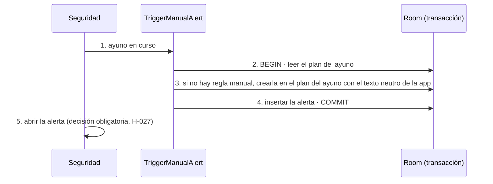

# TRX: «Algo no va bien»

**Historias:** H-023, H-027 · **Disparador:** botón «Algo no va bien» en Seguridad
**Entidades tocadas:** `rule` (C, solo si el plan del ayuno no tiene regla manual), `alert` (C)

## Secuencia

## Manejo de fallos
| Falla en paso | Estado resultante | Acción |
|---|---|---|
| 3–4 | Fallo a mitad | Rollback: no queda una regla manual creada sin su alerta |
| 5 | La app se cierra antes de mostrarla | La alerta queda sin decisión e Inicio la muestra al abrir |

## Idempotencia
Cada pulsación crea una alerta nueva (la persona puede pedir ayuda varias veces). La regla manual se crea una sola vez por ayuno: las pulsaciones siguientes reutilizan la existente. La plantilla nunca se modifica.

Pruebas: `Batch2UseCasesTest` (H-023), `Repositories2Test`, `Batch2aE2eTest`.
