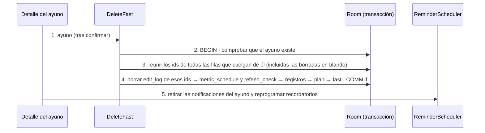

# TRX: Borrar un ayuno para siempre

**Historias:** H-045 · **Disparador:** «Borrar para siempre» en la confirmación de «Borrar ayuno»
**Entidades tocadas (D, físico):** `fast`; `measurement`, `blood_pressure_reading`, `symptom`, `intake`, `product_log`, `alert`, `meal`, `note` (por `fast_id`); `stage`, `plan_metric`, `rule`, `intake_goal`, `checklist_item`, `stage_notice`, `plan_product`, `refeed_step` (por `fast_id`); `metric_schedule` (por `plan_metric_id`); `refeed_check` (por `refeed_step_id`); `edit_log` (por `row_id`). Sin traza del borrado (MODELO-DATOS D-15, ADR-SEG-007)

## Secuencia

## Manejo de fallos
| Falla en paso | Estado resultante | Acción |
|---|---|---|
| 2 | Ayuno inexistente (ya borrado, doble toque) | `FAST_NOT_FOUND`; nada cambia |
| 3–4 | Fallo a mitad del borrado | Rollback: el ayuno queda entero, con todos sus datos; mensaje «No se pudo borrar el ayuno. No se ha borrado nada.» |
| 5 | Falla retirar notificaciones o reprogramar | El ayuno está borrado; una notificación que quede visible no escribe nada al usarla (el receptor no encuentra el ayuno) y las alarmas se recalculan al siguiente arranque |

## Idempotencia
Borrar un ayuno que ya no existe devuelve `FAST_NOT_FOUND` sin escribir nada. El orden del paso 4 no importa para la consistencia (no hay claves foráneas; todo ocurre dentro de la transacción), pero se borra de las hojas a la raíz para que una prueba de rollback a mitad sea legible.

Pruebas: `H045DeleteFastTest` (dominio), `ExchangeTest` «H-045 …» (Room: ninguna fila del ayuno queda en ninguna tabla y el resto no cambia; rollback a mitad), `H045DeleteFastE2eTest`.
