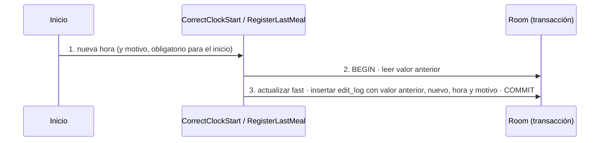

# TRX: Corregir una hora del ayuno con bitácora

**Historias:** H-005 · **Disparador:** «Corregir la hora de inicio» / «Corregir la hora de la última comida»
**Entidades tocadas:** `fast` (U: `clock_start_actual` o `last_meal_actual`), `edit_log` (C)

## Secuencia

## Manejo de fallos
| Falla en paso | Estado resultante | Acción |
|---|---|---|
| 1 | Motivo vacío al corregir el inicio | `REASON_REQUIRED`; nada cambia |
| 2–3 | Fallo a mitad | Rollback: nunca queda un cambio sin su rastro (S8) |

## Idempotencia
Repetir la misma corrección deja otra fila en `edit_log` con el mismo valor anterior y nuevo; el estado del ayuno no cambia. Se acepta: la bitácora refleja lo que hizo la persona.

Pruebas: `TemplateAndFastUseCasesTest` (H-005), `RepositoriesTest` (edit_log en Room).
