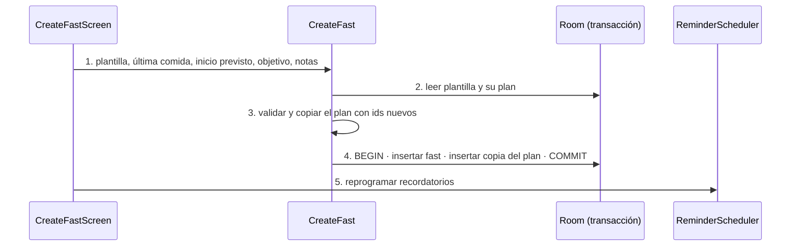

# TRX: Crear ayuno desde plantilla

**Historias:** H-004 · **Disparador:** botón «Crear ayuno»
**Entidades tocadas:** `fast` (C), `stage` (C, copia), `plan_metric` (C, copia), `metric_schedule` (C, copia), `rule` (C, copia)

## Secuencia

## Manejo de fallos
| Falla en paso | Estado resultante | Acción |
|---|---|---|
| 2 | Plantilla inexistente | `TEMPLATE_NOT_FOUND`; nada se escribe |
| 3 | Validación (inicio antes de la última comida, objetivo ≤ 0) | Errores tipados; nada se escribe |
| 4 | Fallo a mitad de la escritura | Rollback: no queda ayuno sin plan ni plan sin ayuno |
| 5 | La reprogramación falla | El ayuno existe; las alarmas se recalculan al siguiente arranque |

## Idempotencia
Cada pulsación crea un ayuno distinto (no es idempotente por diseño: se pueden planificar varios). El botón queda deshabilitado mientras guarda y la pantalla se cierra al confirmar, para evitar el doble toque.

Pruebas: `TemplateAndFastUseCasesTest` (H-004), `RepositoriesTest` (copia en Room), `RoomTransactionRunnerTest` (rollback), `FastLifecycleE2eTest`.
