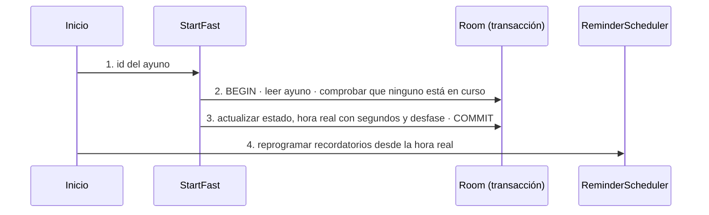

# TRX: Empezar el ayuno

**Historias:** H-005 · **Disparador:** botón «Empieza el ayuno ahora»
**Entidades tocadas:** `fast` (U: `status`, `clock_start_actual`, `tz_offset`)

## Secuencia

## Manejo de fallos
| Falla en paso | Estado resultante | Acción |
|---|---|---|
| 2 | Ya hay otro ayuno en curso, o este no está planificado | `ANOTHER_FAST_IN_PROGRESS` / `FAST_NOT_PLANNED`; nada cambia |
| 3 | Fallo al escribir | Rollback: el ayuno sigue planificado |
| 4 | La reprogramación falla | El ayuno está en curso; alarmas al siguiente arranque o reinicio |

## Idempotencia
La comprobación «solo uno en curso» y el cambio de estado van en la **misma transacción**: un doble toque deja el ayuno en curso una sola vez; el segundo intento devuelve `FAST_NOT_PLANNED` sin cambiar la hora real.

Pruebas: `TemplateAndFastUseCasesTest` (H-005), `RepositoriesTest`, `FastLifecycleE2eTest`.
