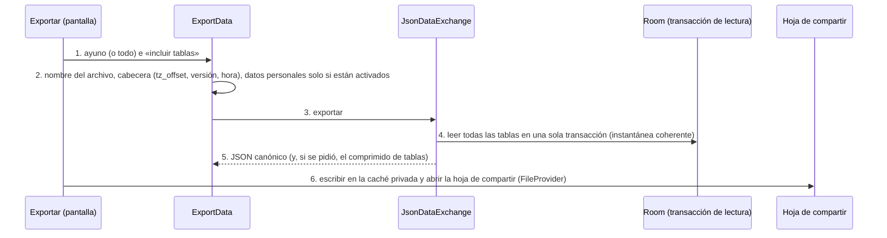

# TRX: Exportar

**Historias:** H-036, H-037, H-038 · **Disparador:** «Exportar» (detalle del ayuno) o «Exportar todo» (Más → Exportar e importar)
**Entidades tocadas:** lectura de todas las entidades del formato (`fast.*`, `template.*`, plan, catálogos, registros, `edit_log.*`); `person_profile.*` solo si `settings.export_person_enabled`

## Secuencia

## Manejo de fallos
| Falla en paso | Estado resultante | Acción |
|---|---|---|
| 2 | Ayuno inexistente o nada que exportar | Error tipado; no se genera archivo |
| 4-5 | Fallo de lectura | No se comparte nada; mensaje llano |
| 6 | Sin espacio o la persona cancela la hoja | El archivo queda en la caché privada y se borra en el siguiente arranque |

## Idempotencia
Solo lee. Reexportar el mismo ayuno produce el mismo contenido salvo `exported_at` (identificadores estables).

Pruebas: `ExchangeTest` (formato, esquema publicado, tablas, datos personales), `Batch4E2eTest` (H-036).
