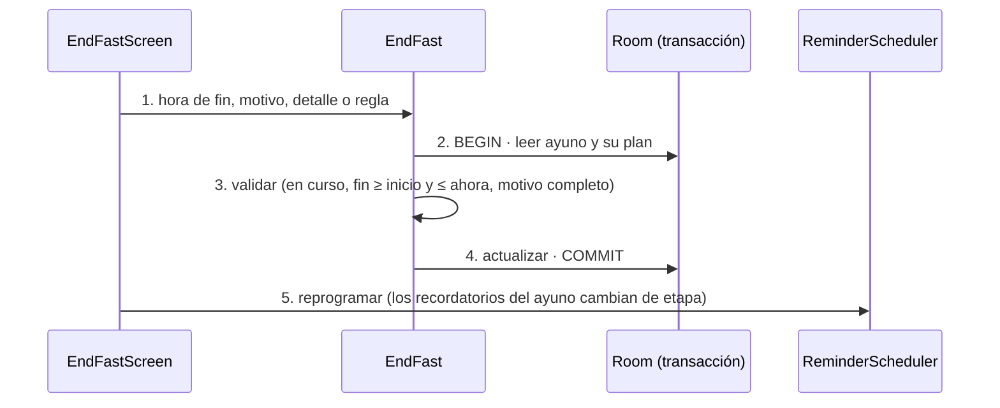

# TRX: Terminar el ayuno

**Historias:** H-030 · **Disparador:** «Terminar el ayuno» (Inicio → reloj, Seguridad o alerta)
**Entidades tocadas:** `fast` (U: `status`, `end_actual`, `end_reason`, `end_reason_detail`, `end_rule_id`)

## Secuencia

## Manejo de fallos
| Falla en paso | Estado resultante | Acción |
|---|---|---|
| 3 | Validación | Errores tipados; el ayuno sigue en curso |
| 4 | Fallo al escribir | Rollback: el ayuno sigue en curso |
| 5 | La reprogramación falla | Alarmas recalculadas al siguiente arranque |

## Idempotencia
Un segundo intento sobre un ayuno ya terminado devuelve `FAST_NOT_IN_PROGRESS`; no se puede reanudar ni terminar dos veces.

**Pendiente (H-031):** al terminar, generar las ocurrencias de la vuelta a comer (`refeed_check`) en la misma transacción.

Pruebas: `TemplateAndFastUseCasesTest` (H-030), `RepositoriesTest`, `FastLifecycleE2eTest`.
