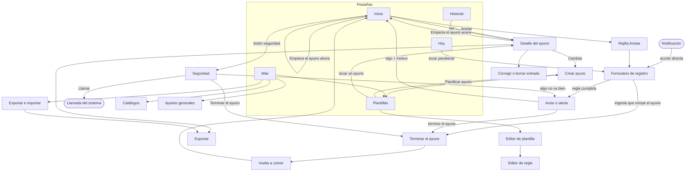

# UX-UI — ayuno-app

Flujos y pantallas de la app móvil. Cada flujo cita sus historias (`specs/HISTORIAS/`) y mapea cada elemento a un campo canónico de `specs/MODELO-DATOS.md`. Los componentes visuales se definirán en `specs/GUIA-ESTILO.md` (aún no existe; se crea en Diseño).

## Convenciones de todos los flujos

- **Modos de mapeo:** `lectura`, `escritura`, `derivado` (calculado, ver *Derivados* del modelo), `acción` (botón o gesto sin campo propio).
- **Estados no felices obligatorios** en cada pantalla: vacío · cargando · error · sin permisos. Como la app es de un solo usuario y sin cuentas, *sin permisos* significa: (a) bloqueo de la app activo (H-042) → se pide huella o PIN del sistema antes de mostrar datos; (b) permiso del sistema denegado (notificaciones, llamadas, archivos) → aviso con botón a los ajustes del teléfono.
- **Lenguaje llano:** frases completas, fechas con día de la semana («viernes 23 de octubre, 07:02»), sin siglas; la hora del ayuno («hora 33») siempre junto a la fecha y hora reales.
- **Accesibilidad:** texto ≥17 pt, objetivos ≥48×48 pt, contraste AA, foco visible, compatible con tamaño de letra del sistema y lector de pantalla. Rojo solo para alertas (`rule.level = alert`); ninguna cifra se colorea por su valor.
- **Fiabilidad:** toda escritura se confirma en pantalla solo después de guardarse en el teléfono (H-008); funciona en modo avión (H-041).

## Índice de flujos

| Flujo | Archivo | Historias |
|---|---|---|
| Inicio y reloj | [ayuno-inicio.md](ayuno-inicio.md) | H-005, H-006, H-041, H-046 |
| Ayunos planificados | [ayuno-planificados.md](ayuno-planificados.md) | H-046, H-005, H-044, H-045 |
| Crear o cambiar un ayuno | [ayuno-crear.md](ayuno-crear.md) | H-004, H-044 |
| Anotar | [registro-anotar.md](registro-anotar.md) | H-008, H-009, H-010, H-012, H-013, H-015, H-035 |
| Recordatorios y Hoy | [recordatorios-hoy.md](recordatorios-hoy.md) | H-015, H-016, H-017, H-018 |
| Seguridad y alertas | [seguridad-alertas.md](seguridad-alertas.md) | H-023, H-025, H-026, H-027, H-028, H-029 |
| Terminar el ayuno | [fin-terminar.md](fin-terminar.md) | H-012, H-027, H-030 |
| Vuelta a comer | [vuelta-a-comer.md](vuelta-a-comer.md) | H-031, H-032 |
| Plantillas | [plantillas-editar.md](plantillas-editar.md) | H-001, H-002, H-003, H-014, H-031 |
| Reglas de alerta | [reglas-editar.md](reglas-editar.md) | H-019, H-020, H-021, H-022, H-023, H-024, H-025, H-026 |
| Historial | [historial-revisar.md](historial-revisar.md) | H-033, H-034, H-035, H-045 |
| Catálogos | [ajustes-catalogos.md](ajustes-catalogos.md) | H-007, H-010, H-011, H-013 |
| Ajustes generales | [ajustes-generales.md](ajustes-generales.md) | H-017, H-029, H-038, H-042, H-043 |
| Exportar e importar | [datos-exportar-importar.md](datos-exportar-importar.md) | H-036, H-037, H-038, H-039, H-040 |

H-041 (sin conexión ni cuenta) es transversal: ningún flujo pide conexión ni inicio de sesión.

## Navegación global

Barra inferior con 5 pestañas (patrón estándar de app móvil): **Inicio**, **Planificados** (EV-002), **Hoy**, **Historial**, **Más** (plantillas, catálogos, ajustes, exportar). Durante un ayuno en curso, «Anotar» y el botón de seguridad flotan sobre Inicio y Hoy.

## Decisiones de producto

*Propuestas aceptadas por el humano el 2026-10-08.*

Ver la sección final de cada flujo; resumen en la entrega del paso 4.
